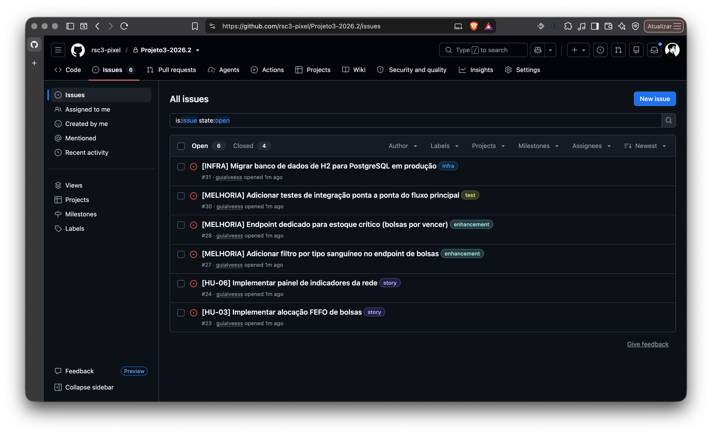
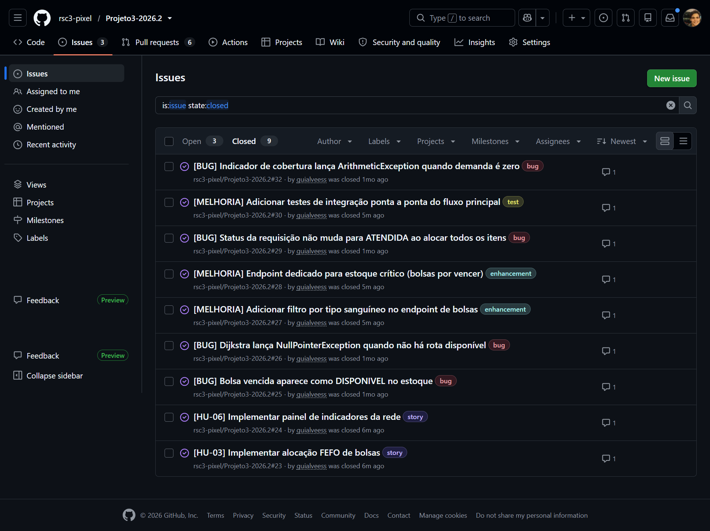

# Rota Vital

Plataforma web para distribuição de hemocomponentes: gestão de estoque, alocação de bolsas
compatíveis e roteirização respeitando cadeia fria e janelas de tempo.

## Descrição do projeto

A rede de sangue precisa garantir o componente certo (compatível e dentro da validade), no
lugar certo, no tempo certo e na temperatura certa. Falhas geram desabastecimento, descarte
por vencimento e risco ao paciente. Hoje falta uma plataforma que integre estoque,
compatibilidade e roteirização em um só lugar.

O Rota Vital é uma aplicação web que:

- gerencia o estoque de hemocomponentes;
- recebe requisições hospitalares;
- aloca bolsas compatíveis priorizando validade;
- calcula rotas de distribuição respeitando cadeia fria e janelas de tempo;
- apresenta painéis de indicadores de estoque/demanda e de monitoramento de temperatura.

### Competências trabalhadas

POO e Spring Boot; grafos e caminhos mínimos; matching de compatibilidade; filas de
prioridade e hash; estatística descritiva e probabilidade aplicadas; concorrência; CI/CD e
nuvem; arquitetura de redes e telemetria; trabalho em equipe.

### Limites e cuidados

- Apenas dados sintéticos, sem informações reais de doadores ou pacientes (LGPD).
- A telemetria de temperatura/GPS é simulada.
- A compatibilidade ABO/Rh é didática e não substitui protocolo clínico.

## Tecnologias usadas

| Camada | Tecnologia |
|---|---|
| Linguagem | Java 21 (LTS) |
| Framework web | Spring Boot 4.1.1 |
| Build | Maven, via wrapper (`mvnw`) |
| Persistência | Spring Data JPA / Hibernate |
| Banco de dados | H2 em memória (desenvolvimento) · PostgreSQL previsto para a Entrega 02 |
| Front-end | HTML/CSS/JS estático (`src/main/resources/static/painel.html`) |
| Testes | JUnit 5 |
| Integração contínua | GitHub Actions |
| Análise de dados | Python 3 (biblioteca padrão) |
| Prototipação | Figma |
| Diagramas | draw.io |
| Controle de versão | Git / GitHub |

## Entregas

### Entrega 01

**Status:** entregue em 31/08/2026

**Artefatos**

| Artefato | Link |
|---|---|
| Histórias de usuário com cenários BDD | [docs/historias-de-usuario.md](docs/historias-de-usuario.md) |
| Protótipo Lo-Fi (Figma) | [abrir protótipo](https://www.figma.com/make/FjQBa3isHRI4lxbASP8AEn/Dark-Web-Blood-Bank-Prototype?p=f&t=b0uZNhfKp6MHIZBO-0&fullscreen=1) |
| Screencast do protótipo | [assistir no YouTube](https://youtu.be/33CGLaHzz9A) |
| Modelo de domínio (diagrama de classes) | [dominio.png](dominio.png) · [dominio.drawio](dominio.drawio) |
| Contrato da API REST | [contrato_api.md](contrato_api.md) |
| Arquitetura de rede | [diagrama_arquitetura_redes.png](diagrama_arquitetura_redes.png) |
| Escopo do grafo de distribuição | [docs/W02-escopo-grafo-rede-distribuicao.md](docs/W02-escopo-grafo-rede-distribuicao.md) · [diagrama](docs/img/W02-grafo-rede-distribuicao.png) |
| Estruturas de dados (grafo, FEFO, índice) | [docs/W04-estruturas-base.md](docs/W04-estruturas-base.md) |
| Complexidade das estruturas | [docs/complexidade-estruturas.md](docs/complexidade-estruturas.md) |
| Análise estatística (CRISP-DM) | [dados/crisp-dm-briefing.md](dados/crisp-dm-briefing.md) |
| Sumário executivo e evidências EST U1 | [docs/evidencias-unidade-1-est.md](docs/evidencias-unidade-1-est.md) |
| Apresentação do pitch | [apresentacao/pitch-crisp-dm.html](apresentacao/pitch-crisp-dm.html) |

### Entrega 02

**Status:** entregue em 21/09/2026

**Artefatos**

| Artefato | Link |
|---|---|
| **Aplicação no ar** | [rsc3-rotavital.duckdns.org](https://rsc3-rotavital.duckdns.org/api/v1/hemocentros) |
| **Painel de indicadores** | [/painel.html](https://rsc3-rotavital.duckdns.org/painel.html) |
| **API Reference (Scalar)** | [/docs](https://rsc3-rotavital.duckdns.org/docs) |
| Pipeline e deploy | [docs/deploy.md](docs/deploy.md) |
| Evidências SO (U1) | [docs/evidencias-unidade-1-so.md](docs/evidencias-unidade-1-so.md) · [subtarefas](docs/checkpoint-so-subtarefas.md) |
| Evidências EST (U1) | [docs/evidencias-unidade-1-est.md](docs/evidencias-unidade-1-est.md) |
| Evidências AED (U1) | [docs/evidencias-unidade-1-aed.md](docs/evidencias-unidade-1-aed.md) · [tradução C→Java](docs/U1-traducao-c-java.md) |
| Evidências RSD (U1) | [docs/evidencias-unidade-1-rsd.md](docs/evidencias-unidade-1-rsd.md) |
| Padrões de projeto (POO U1) | [docs/padroes-poo.md](docs/padroes-poo.md) |
| Histórias de usuário | [docs/historias-de-usuario.md](docs/historias-de-usuario.md) |
| Issue / Bug tracker | [github.com/…/issues](https://github.com/rsc3-pixel/Projeto3-2026.2/issues) |
| Screencast do sistema | [assistir no YouTube](https://youtu.be/2tbx00ujZmo) |
| Screencast do código | [assistir](https://luvaplay.com.br/game/screwcast-codigo.mp4) |

#### Histórias implementadas

**HU-03 — Alocar bolsa priorizando validade (FEFO)**

| | |
|---|---|
| **Como** | técnico do hemocentro |
| **Quero** | que o sistema indique qual bolsa separar para cada item da requisição |
| **Para que** | eu use primeiro a que vence antes e reduza o descarte |

**Critérios de aceite:**
- Entre bolsas equivalentes, sempre sai a de validade mais próxima
- Bolsa vencida nunca entra na seleção
- Empate de validade resolvido de forma determinística
- Atendimento parcial é registrado, não tratado como falha

**Implementação:** `SelecaoFefo.java` (fila de prioridade FEFO) · `ServicoAlocacaoRota.java` · endpoint `POST /api/v1/requisicoes/{id}/itens/{itemId}/alocacoes`

---

**HU-06 — Acompanhar indicadores da rede**

| | |
|---|---|
| **Como** | coordenador da rede |
| **Quero** | ver estoque, descarte e cobertura de demanda por tipo sanguíneo |
| **Para que** | eu identifique onde falta sangue antes que vire desabastecimento |

**Critérios de aceite:**
- Indicadores calculados a partir do estoque real, não valores fixos
- Tipos com cobertura abaixo de 100% aparecem destacados
- Painel mostra medidas de dispersão, não só média
- Cada indicador exibe a unidade e o período considerado

**Implementação:** `IndicadorServico.java` · `IndicadorController.java` · endpoints `GET /api/v1/indicadores/*`

---

#### Issue / Bug tracker



### Entrega 03

**Status:** entregue em 19/10/2026

**Artefatos**

| Artefato | Link |
|---|---|
| SO U2 — cenários e dimensionamento de arquitetura | [docs/so-u2-cenarios-dimensionamento.md](docs/so-u2-cenarios-dimensionamento.md) |
| SO U2 — orçamento mensal dos três cenários | [docs/so-u2-orcamento-mensal.md](docs/so-u2-orcamento-mensal.md) |
| **Aplicação no ar** | [rsc3-rotavital.duckdns.org](https://rsc3-rotavital.duckdns.org/api/v1/hemocentros) |
| **API Reference (Scalar)** | [/docs](https://rsc3-rotavital.duckdns.org/docs) |
| Contrato da API | [contrato_api.md](https://github.com/rsc3-pixel/Projeto3-2026.2/blob/main/contrato_api.md) |
| Histórias de usuário | [docs/historias-de-usuario.md](https://github.com/rsc3-pixel/Projeto3-2026.2/blob/main/docs/historias-de-usuario.md) |
| Issue / Bug tracker | [github.com/…/issues](https://github.com/rsc3-pixel/Projeto3-2026.2/issues) |
| Screencast do sistema | [assistir](https://luvaplay.com.br/game/Video01-%20O%20sistema.mp4) |
| Screencast do código | [assistir](https://luvaplay.com.br/game/Video02-Ocodigo.mp4) |

#### Histórias implementadas

**HU-07 — Monitorar temperatura durante o transporte**

| | |
|---|---|
| **Como** | técnico do hemocentro |
| **Quero** | ser avisado quando a temperatura de uma remessa sair da faixa exigida |
| **Para que** | eu possa agir antes que as bolsas se tornem inviáveis |

**Critérios de aceite:**
- A faixa aceita é a do componente transportado, não um valor único
- Remessa com componentes de faixas diferentes avalia cada um
- Leitura fora da faixa gera alerta imediato
- Histórico de leituras fica registrado por remessa
- A telemetria é simulada nesta fase do projeto

A faixa depende do componente: hemácias de 1 a 6 °C, plaquetas de 20 a 24 °C,
plasma e crioprecipitado de −25 a −18 °C. Uma remessa pode levar tipos
diferentes no mesmo compartimento, e nesse caso a mesma leitura pode estar
correta para um e ser excursão para outro. Por isso a resposta traz uma lista
de alertas, não um valor único.

**Implementação:** `TemperaturaServico.java` · `LeituraTemperatura.java` · endpoints `POST` e `GET /api/v1/rotas/{id}/temperaturas`

---

**HU-08 — Alocar respeitando compatibilidade ABO/Rh**

| | |
|---|---|
| **Como** | técnico do hemocentro |
| **Quero** | que o sistema só me ofereça bolsas compatíveis com o grupo do paciente |
| **Para que** | eu não dependa de consultar a tabela de compatibilidade de cabeça |

**Critérios de aceite:**
- Bolsa compatível de grupo diferente é oferecida, não apenas a de grupo idêntico
- Bolsa incompatível nunca entra na seleção, mesmo sendo a única disponível
- A compatibilidade é aplicada antes da ordenação por validade
- Entre bolsas compatíveis, a regra FEFO continua valendo
- A relação não é tratada como simétrica

Antes desta história a alocação comparava o grupo por igualdade, o que recusava
doação válida: um paciente A+ só recebia bolsa A+, embora possa receber de O−,
O+ e A− também. A regra varia por hemocomponente, porque plasma e
crioprecipitado carregam anticorpos e seguem tabela invertida em relação às
hemácias.

**Implementação:** `MatrizCompatibilidade.java` · `RequisicaoServico.java` · endpoint `POST /api/v1/requisicoes/{id}/itens/{itemId}/alocacoes`

A compatibilidade implementada é didática e não substitui protocolo clínico.

---

#### Issue / Bug tracker



Nove issues resolvidas e três em aberto. As duas abertas nesta sprint vieram de
defeitos encontrados durante a implementação:

| Issue | O que é |
|---|---|
| [#57](https://github.com/rsc3-pixel/Projeto3-2026.2/issues/57) | existem dois caminhos de alocação, e o endpoint real ignora o índice e o FEFO |
| [#58](https://github.com/rsc3-pixel/Projeto3-2026.2/issues/58) | `proxy_read_timeout` do Nginx corta o cold start e devolve 504 |

### Entrega 04

**Status:** não iniciada

**Artefatos:** _(a preencher)_

**Screenshots:** _(a preencher)_

## Como rodar o projeto

### Pré-requisitos

- **JDK 21** (LTS). Confira com `java -version`.
- Não é preciso instalar o Maven: o projeto usa o Maven Wrapper (`mvnw`), que
  baixa a versão correta na primeira execução.

### Executando

```bash
# clonar o repositório
git clone https://github.com/rsc3-pixel/Projeto3-2026.2.git
cd Projeto3-2026.2

# Linux / macOS
./mvnw spring-boot:run

# Windows (PowerShell ou cmd)
.\mvnw.cmd spring-boot:run
```

A primeira execução baixa as dependências e demora alguns minutos. As
seguintes sobem em poucos segundos.

A aplicação fica disponível em `http://localhost:8080`.

### Aplicação em produção

A API está no ar, publicada automaticamente a cada push na `main`:

| URL | O que é |
|---|---|
| [`/actuator/health`](https://rsc3-rotavital.duckdns.org/actuator/health) | estado da aplicação |
| [`/painel.html`](https://rsc3-rotavital.duckdns.org/painel.html) | painel de indicadores de estoque e demanda |
| [`/docs`](https://rsc3-rotavital.duckdns.org/docs) | API Reference interativa (Scalar) |
| [`/api/v1/hemocentros`](https://rsc3-rotavital.duckdns.org/api/v1/hemocentros) | os hemocentros da carga inicial |
| [`/api/v1/bolsas`](https://rsc3-rotavital.duckdns.org/api/v1/bolsas) | o estoque |

Base: `https://rsc3-rotavital.duckdns.org`

O pipeline está em [.github/workflows/ci.yml](.github/workflows/ci.yml) e o
processo em [docs/deploy.md](docs/deploy.md).

### Endpoints disponíveis (execução local)

| URL | O que é |
|---|---|
| `http://localhost:8080/actuator/health` | Estado da aplicação (`{"status":"UP"}`) |
| `http://localhost:8080/painel.html` | Painel de indicadores (EST) |
| `http://localhost:8080/docs` | API Reference interativa (Scalar) |
| `http://localhost:8080/h2-console` | Console do banco H2 |

Os endpoints de negócio seguem o [contrato_api.md](contrato_api.md):

| Recurso | Operações |
|---|---|
| `/api/v1/hemocentros` | GET, POST, PUT, DELETE; sub-recursos `/bolsas` e `/rotas` |
| `/api/v1/hospitais` | GET, POST, PUT, DELETE; sub-recurso `/requisicoes` |
| `/api/v1/bolsas` | GET, POST, PATCH (status), DELETE |
| `/api/v1/requisicoes` | GET, POST, PATCH (cancelamento); sub-recursos `/itens` e `/itens/{id}/alocacoes` |
| `/api/v1/rotas` | GET, POST, PATCH (status); sub-recurso `/bolsas` (embarque) |

Ao subir, a aplicação carrega dados sintéticos (4 hemocentros, 6 hospitais,
100 bolsas e requisições) para que a API já responda com conteúdo. A carga
está em `CargaInicial.java` e não roda no perfil de teste.

**Códigos de resposta:** 200/201/204 no caminho feliz, 400 para corpo
inválido (com os campos apontados), 404 para recurso inexistente e 409 quando
a operação fere uma regra de negócio (bolsa incompatível, transição de status
proibida, remoção de unidade com vínculos).

### Acessando o console do H2

Em `http://localhost:8080/h2-console`, preencha:

| Campo | Valor |
|---|---|
| JDBC URL | `jdbc:h2:mem:rotavital` |
| User Name | `sa` |
| Password | *(deixe em branco)* |

O banco é **em memória**: os dados existem enquanto a aplicação estiver
rodando e são perdidos ao parar. A migração para PostgreSQL está prevista para
a Entrega 02 e exige apenas trocar a URL e o driver em
`src/main/resources/application.properties`.

### Outros comandos

```bash
./mvnw clean compile   # compila
./mvnw test            # roda os testes
./mvnw clean package   # gera o jar em target/
```

### Rodando em modo produção

Para reproduzir localmente o que roda na VM:

```bash
./mvnw clean package -DskipTests
java -jar target/rota-vital-0.0.1-SNAPSHOT.jar --spring.profiles.active=prod
```

O perfil `prod` desliga o console do H2, restringe o Actuator ao `/health`,
tira o SQL do log e faz a aplicação escutar em `127.0.0.1:8081` — na VM ela
fica atrás do Nginx, servida em `/rota-vital/`. Ver
[application-prod.properties](src/main/resources/application-prod.properties)
e [docs/deploy.md](docs/deploy.md).

> Rodando localmente com o perfil `prod`, a aplicação responde em
> `http://localhost:8081`, não na 8080.

## Desafio de Infraestrutura de Software — Container, TDD e Deploy

Unidade 2 · entrega em grupo · os **integrantes** estão na seção [Equipe](#equipe).

### Como rodar

**Com Docker, do zero, em qualquer máquina:**

```bash
git clone https://github.com/rsc3-pixel/Projeto3-2026.2.git
cd Projeto3-2026.2
cp .env.example .env          # defina DB_PASSWORD
docker compose up -d --build
```

Sobe a API e o PostgreSQL. Nada precisa estar instalado antes: nem Java, nem
Maven, nem banco. A aplicação responde em `http://localhost:8080`.

```bash
docker compose ps             # os dois serviços devem estar healthy
docker compose logs -f api    # acompanhar a subida
docker compose down           # parar, mantendo os dados no volume
docker compose down -v        # parar e apagar os dados
```

**Sem Docker**, com JDK 21:

```bash
./mvnw spring-boot:run
```

Usa H2 em memória, sem banco externo.

### Testes

```bash
./mvnw test                                  # a suíte completa
./mvnw test -Dtest=CenariosAceitacaoTest     # só os de aceitação
```

São **421 testes** em três níveis:

| Nível | O que exercita | Onde |
|---|---|---|
| Unitário | uma regra isolada, sem Spring | `MatrizCompatibilidadeTest`, `SelecaoFefoTest` |
| Integração | um endpoint, com banco | `FluxoRequisicaoTest`, `TemperaturaRemessaTest` |
| Aceitação | um cenário da história, de ponta a ponta | `CenariosAceitacaoTest` |

Os testes de aceitação traduzem os cenários escritos em Gherkin no
[documento de histórias](docs/historias-de-usuario.md), com a estrutura
`Dado / Quando / Então` visível no nome e nos comentários.

O [story map](docs/story-map.md) mostra o backbone do produto, as oito
histórias da Release 1 quebradas em tarefas, e qual regra ganhou teste
primeiro.

### Pipeline e deploy

[`.github/workflows/ci.yml`](.github/workflows/ci.yml)

```
build → testes → imagem → deploy
```

| Job | O que faz | Quando |
|---|---|---|
| **Build** | compila | todo push e PR |
| **Testes** | roda os 421 testes | depois do build |
| **Imagem** | constrói a imagem Docker e publica no GHCR | depois dos testes |
| **Empacotamento** | gera o jar como artefato | depois dos testes |
| **Deploy** | publica na VM por SSH | só na `main`, nunca em PR |

Os jobs são encadeados por `needs`: **um teste vermelho barra tudo o que vem
depois**, inclusive o deploy. É o portão que o enunciado pede.

**Aplicação no ar:** <https://rsc3-rotavital.duckdns.org>

#### Como fazer rollback

O jar anterior fica guardado na VM a cada deploy:

```bash
gcloud compute ssh flux --zone=us-west1-a
sudo systemctl stop rota-vital
sudo cp /opt/rota-vital/rota-vital.jar.anterior /opt/rota-vital/rota-vital.jar
sudo systemctl start rota-vital
curl -s https://rsc3-rotavital.duckdns.org/actuator/health
```

Pela imagem, quando o deploy por container estiver ativo:

```bash
docker compose pull ghcr.io/rsc3-pixel/rota-vital:<sha-anterior>
docker compose up -d
```

Cada imagem é marcada com o SHA do commit, então voltar é apontar para a tag
anterior.

### Decisões

Uma linha por decisão: o que escolhemos, o que havia como alternativa, e o
porquê.

| Decisão | Alternativas | Por quê |
|---|---|---|
| **Imagem base**: `eclipse-temurin:21-jre-alpine` | `21-jdk`, `21-jre` (Debian) | JRE porque executar não exige compilador; Alpine baixa de ~450 MB para 410 MB e traz menos pacotes a acompanhar em boletim de segurança |
| **Multi-stage** | estágio único | o 2º estágio leva só o jar; sem isso a imagem carregaria Maven, JDK e código-fonte, e tudo isso vira superfície de ataque |
| **Testes dentro do build** | só no CI | a imagem não é gerada se um teste falhar, mesmo compilando na máquina de quem clonou |
| **Banco**: PostgreSQL no Docker, H2 fora | só H2, só PostgreSQL | o desafio pede volume para os dados, e H2 em memória não sobrevive a reinício. H2 continua no perfil padrão porque sobe junto com a aplicação e não exige nada instalado |
| **Volume nomeado** | bind mount | os dados ficam sob gestão do Docker e sobrevivem ao `compose down`; bind mount depende de caminho e permissão, e costuma quebrar entre Windows, macOS e Linux |
| **`depends_on: service_healthy`** | `service_started` | sem isso a API tentaria conectar durante a inicialização do Postgres, falharia e entraria em laço de reinício |
| **Rede própria do Compose** | rede default | os serviços se encontram pelo nome (`banco`, `api`) e ficam isolados de outros containers na máquina |
| **Porta do banco não publicada** | expor 5432 | só a API precisa alcançá-lo, e faz isso pela rede interna |
| **Primeiro teste: compatibilidade ABO/Rh** | FEFO, cadastro | um erro ali põe um paciente em risco. E o defeito era real: a alocação comparava grupos por igualdade e recusava doação válida de O− |
| **Segundo: filtro antes da ordenação no FEFO** | ordenar e filtrar depois | o FEFO põe no topo quem vence primeiro, e bolsa vencida vence antes de todas; filtrando depois, ela ocuparia o topo em toda seleção |
| **Aceitação em JUnit** | Cucumber com `.feature` | o enunciado diz que *pode* ser Gherkin, não que precisa ser; os cenários já estavam escritos, e Cucumber traria duas dependências e uma camada de cola sem acrescentar garantia |
| **CI/CD**: GitHub Actions | GitLab CI, Jenkins | o código já está no GitHub; sem ferramenta a mais para manter |
| **Fluxo de branch**: GitHub Flow | Git Flow, GitLab Flow | grupo pequeno, uma versão no ar, deploy a cada merge. Git Flow traria branches de release e hotfix que esta cadência não usa |
| **Deploy**: VM no Google Cloud por SSH | Render, Railway, Fly.io | a VM já tem domínio próprio e HTTPS com Let's Encrypt, e é a evidência das entregas de SO e RSD. Os planos gratuitos hibernam, o que pioraria o cold start que já enfrentamos |
| **Segredos**: GitHub Secrets | `.env` versionado, hardcode | `VM_HOST`, `VM_USUARIO` e `VM_CHAVE_SSH` ficam no cofre do GitHub; o `.env` está no `.gitignore` e o `.env.example` documenta as variáveis sem conter valor nenhum |
| **Jar por SSH, não imagem** | deploy por container | decisão de hoje, por limite de memória: a VM tem 955 MB e 296 livres, e os containers somariam ~510 MB. O pipeline já publica a imagem; o deploy por container entra quando a infraestrutura comportar |

### Uso de IA

Declarado, conforme o enunciado pede.

**Ferramenta:** Claude (Anthropic), via Claude Code no terminal.

Usamos a ferramenta para acelerar rascunho e redação, sempre a partir de
decisões que já tínhamos tomado. As escolhas de arquitetura, a priorização do
backlog e a definição do que entra em cada release são nossas, e cada saída
passou por execução real antes de entrar no repositório.

**O que pedimos a ela, e como verificamos:**

| Etapa | O que pedimos | Como verificamos |
|---|---|---|
| Dockerfile e compose | um rascunho da estrutura multi-stage que tínhamos definido | subimos do zero, conferimos os healthchecks e provamos a persistência reiniciando os containers |
| Testes | sugestões de casos de borda para os cenários que escrevemos | rodamos a suíte: **um falhou**, e a investigação revelou uma regra do sistema que não estava documentada |
| Story map | organização do backbone a partir das histórias que já existiam | revisamos a classificação de cada tarefa contra o código em produção |
| Documentação | redação das justificativas das decisões | conferimos cada número contra medição real na máquina |

**Como conduzimos o trabalho:**

- "Confere se temos algo sobre isso no nosso repositório": levantamos o que já existia antes de aceitar qualquer código novo
- "Cuidado para não alucinar por falta de contexto": exigimos verificação antes de afirmação
- "Vamos para a E2 e depois tentamos resolver esse problema": a ordem de ataque foi decisão nossa

**O que a verificação pegou:**

Os três casos abaixo são a razão de cada saída passar por execução antes de
entrar no repositório.

- A justificativa escrita afirmava que a colisão no índice de estoque era "rara por construção". Medimos, e não se sustentou: `Objects.hash` sobre enum usa hash de identidade, que varia entre execuções. A chave passou a usar `ordinal()`
- Um teste sugerido supunha que bolsa vencida seria recusada na alocação. Ao rodar, ele falhou, e a investigação mostrou que a recusa acontece antes, **na entrada do estoque**
- Um `COPY infra/` faltando no Dockerfile derrubou o build, porque um teste lê a configuração do Nginx para conferir a porta

Cada um foi pego por um mecanismo diferente: o primeiro por medição
deliberada, depois que a afirmação já estava escrita na documentação
(PI3-132); o segundo pela suíte de testes, ainda no desenvolvimento; o
terceiro pelo build, que não gera imagem com teste falhando. Validamos,
corrigimos e assinamos o resultado.

### Evidências

| | |
|---|---|
| Container funcionando | [docs/evidencias/e1-container.md](docs/evidencias/e1-container.md) |
| Esteira barrando e entregando | [docs/evidencias/e3-pipeline.md](docs/evidencias/e3-pipeline.md) |
| Execuções do pipeline | [aba Actions](https://github.com/rsc3-pixel/Projeto3-2026.2/actions) |
| Aplicação no ar | <https://rsc3-rotavital.duckdns.org/actuator/health> |
| Issue tracker | [9 resolvidas, 3 abertas](https://github.com/rsc3-pixel/Projeto3-2026.2/issues) |


## Documentação técnica

Material de apoio, não exigido pelas entregas:

| Documento | O que cobre |
|---|---|
| [docs/entendendo-o-rota-vital.md](docs/entendendo-o-rota-vital.md) | guia comentado do código, do modelo de domínio ao deploy |
| [docs/plano-frontends.md](docs/plano-frontends.md) | plano dos dois front-ends: Thymeleaf e Angular |

## Equipe

| Nome completo | E-mail da school |
|---|---|
| Cauã Rego Tavares Leite Duarte | crtld@cesar.school |
| Fernando Andrade Leandro Peixoto | falp2@cesar.school |
| Gabriel Brito Ferreira Dias | gbfd@cesar.school |
| Guilherme Alves de Souza | gas6@cesar.school |
| Lucas Ferreira Torres de Albuquerque | lfta@cesar.school |
| Maria Eduarda Vasconcelos | mevs@cesar.school |
| Renato Santos Chong | rsc3@cesar.school |
| Victor Barros Roma | vbr@cesar.school |


## Membros anteriores / novos

| Nome completo | E-mail da school | Entrada | Saída |
|---|---|---|---|
| _(nenhum até o momento)_ | | | |
