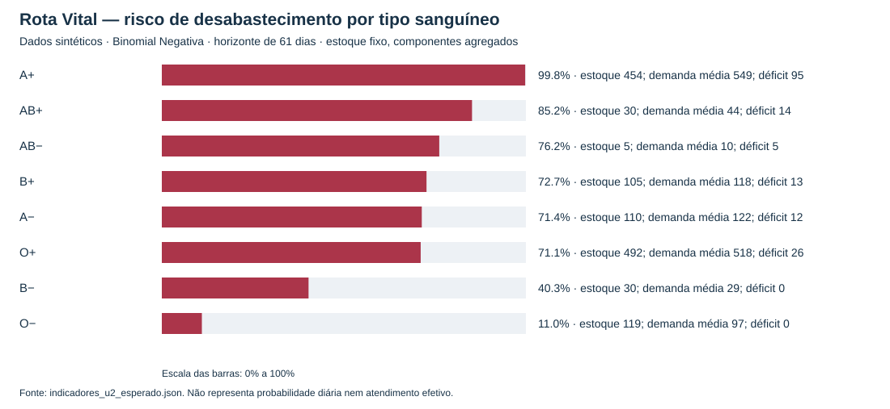
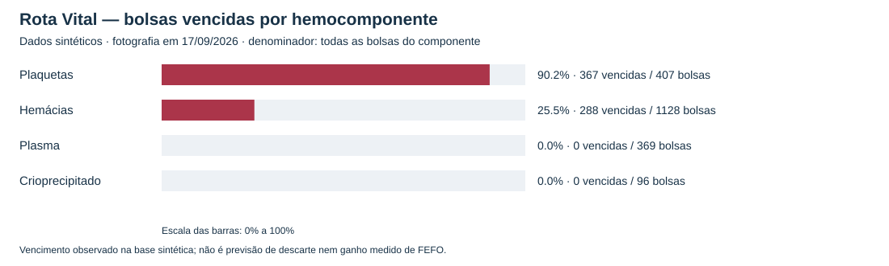
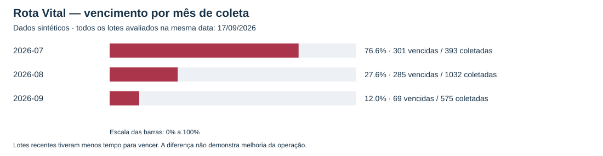

# W14 — Relatório de achados, interpretação e decisões (EST U2)

**Rubrica:** Interpretação e decisão (30%). **Compilação:** 03/11/2026.

**Todos os dados deste relatório são sintéticos.** Não são registros de pacientes, doadores ou resultados reais de uma hemorrede. As conclusões descrevem o cenário didático do Rota Vital e orientam hipóteses de gestão a avaliar.

## Sumário executivo

O Rota Vital precisa tratar **risco de falta e exposição ao vencimento em conjunto**. A+ reúne o maior déficit pontual (95 bolsas) e probabilidade modelada de falta de 99,8%. B− evidencia por que a cobertura isolada é insuficiente: mesmo com 103,4% de cobertura, o risco estimado é de 40,3%. O− também tem risco residual de 11,0%, apesar do excedente aritmético de 22 bolsas.

O vencimento concentra-se em plaquetas: 367 de 407 bolsas (90,2%) estão vencidas na fotografia sintética. Entre todas as 655 bolsas vencidas, 620 tiveram pelo menos um pedido compatível durante a validade. Esse número é **um limite superior de oportunidade de alocação**, não uma quantidade comprovadamente recuperável pelo FEFO. A análise não disputa quantidades dos pedidos nem verifica transporte e temperatura.

A decisão proposta é revisar primeiro as combinações de componente, tipo e unidade com maior risco e déficit; usar FEFO entre bolsas elegíveis ao atendimento; e avaliar reposição em lotes compatíveis com o consumo e a validade. O relatório não autoriza uma substituição automática por O− nem demonstra que aumentar coleta ou aplicar FEFO, isoladamente, resolverá o problema.

## 1. Base, método e alcance

| Aspecto | Definição usada nesta entrega |
|---|---|
| Base | [dados_sinteticos.json](../dados/dados_sinteticos.json): 2.000 bolsas, 300 requisições, 1.487 bolsas demandadas |
| Referência do estoque | **17/09/2026**, conforme a base U2; 1.345 bolsas válidas e 655 vencidas |
| Horizonte de demanda | **19/07/2026 a 17/09/2026, 61 dias inclusive** |
| Desabastecimento | Evento `D > S`: demanda aleatória no horizonte maior que o estoque válido fixo |
| Modelo adotado | Binomial Negativa com média total observada e variância do horizonte calculada pela série diária; Poisson é comparação |
| Descarte | Proporção de bolsas vencidas na fotografia, por componente ou período de **coleta** |
| Oportunidade FEFO | Bolsa vencida com pelo menos um pedido do mesmo componente e tipo compatível entre coleta e validade, inclusive |
| Evidência numérica principal | [indicadores_u2_esperado.json](../dados/indicadores_u2_esperado.json), recalculado por [validar_indicadores_u2.py](../dados/validar_indicadores_u2.py) |

A [PI3-102](modelagem_demanda_desabastecimento_cpp.md) fundamenta o modelo de demanda e apresenta comparação com bootstrap. A [PI3-103](evidencias-pi3-103.md) documenta os indicadores de descarte. A [PI3-32](evidencias-pi3-32.md) descreve sua integração ao painel. Esta W14 interpreta essas entregas; não introduz outro modelo nem altera políticas da aplicação.

As duas medidas têm significados diferentes: `P(D>S)` é uma probabilidade de modelo; `vencidas/total` pode ser lida como a probabilidade empírica de selecionar uma bolsa vencida, escolhendo uniformemente uma bolsa daquele recorte. A segunda **não é uma previsão de que uma bolsa válida será descartada no futuro**. O campo “descarte” também não registra um procedimento físico de descarte realizado.

O estoque é mantido fixo no cálculo de falta, sem simular reposição, consumo sequencial ou vencimentos durante os próximos 61 dias. O modelo não estima risco diário. A variância usa a hipótese de dias independentes, e o bootstrap reamostra a mesma série sintética: sua concordância ajuda a comparar métodos, mas não valida o modelo para dados reais ou garante ausência de dependência temporal. Os parâmetros não incluem intervalos de incerteza nesta entrega.

## 2. Achados sobre desabastecimento

### 2.1. Risco e volume orientam decisões diferentes

| Tipo | Estoque válido | Demanda média no horizonte | Cobertura | Déficit pontual | P(falta), BN | Decisão de gestão proposta |
|---|---:|---:|---:|---:|---:|---|
| A+ | 454 | 549 | 82,7% | 95 | **99,8%** | Primeira revisão de capacidade de reposição pelo volume; detalhar componente e unidade antes de definir lote |
| AB+ | 30 | 44 | 68,2% | 14 | **85,2%** | Revisar pedidos programados e alternativas de remanejamento elegíveis |
| AB− | 5 | 10 | 50,0% | 5 | **76,2%** | Tratar baixa cobertura como alerta mesmo com déficit absoluto pequeno; verificar disponibilidade por componente |
| B+ | 105 | 118 | 89,0% | 13 | **72,7%** | Planejar reposição e acompanhar variação da demanda, sem esperar esgotamento |
| A− | 110 | 122 | 90,2% | 12 | **71,4%** | Revisar margem de estoque e prazos dos pedidos elegíveis |
| O+ | 492 | 518 | 95,0% | 26 | **71,1%** | Considerar o volume de 26 bolsas na revisão de reposição, apesar da cobertura próxima de 100% |
| B− | 30 | 29 | 103,4% | 0 | **40,3%** | Não liberar a única bolsa de excedente como se fosse folga garantida; avaliar estoque de segurança |
| O− | 119 | 97 | 122,7% | 0 | **11,0%** | Avaliar impacto de cada transferência sobre a demanda própria; não tratar excedente agregado como reserva universal |

**Interpretação:** a prioridade de revisão de estoque combina probabilidade, déficit absoluto e cobertura. Isso não substitui a prioridade de atendimento de cada requisição. A+ tem maior déficit, enquanto AB− tem menor cobertura; usar apenas um desses critérios esconderia parte do problema. O déficit pontual não é o número esperado de bolsas faltantes sob o modelo e não determina automaticamente o lote de compra/coleta.

As probabilidades por tipo agregam componentes diferentes. Uma bolsa de plasma não supre uma requisição de hemácias por compartilhar o mesmo grupo. Antes de alocar ou redistribuir, o Rota Vital deve verificar componente, matriz de compatibilidade implementada, validade, saldo disponível, destino, prazo e condições de transporte. As decisões são propostas operacionais do projeto, não regras clínicas de transfusão.



**Figura 1.** Cada barra representa `P(D>S)` pela Binomial Negativa, no horizonte acumulado de 61 dias. Não é percentual de pedidos recusados nem frequência real de falta.

### 2.2. Cobertura não mede proteção contra variação da demanda

B− tem apenas uma bolsa acima da demanda média. A demanda pode ultrapassar esse saldo: **40,3% de risco**, apesar de cobertura maior que 100%. O− tem 22 bolsas de excedente, mas ainda apresenta **11,0% de risco**. A decisão é avaliar reservas por componente e prazo de reposição, com um nível de serviço a definir pelo projeto, em vez de transferir automaticamente todo o excedente.

O cenário tem falta líquida de **142 bolsas** (`1.487 − 1.345`), mas a soma dos déficits por tipo é **165**. A diferença são 23 bolsas de excedente aritmético em B− e O−. Esses totais não comprovam atendimento ou intercambialidade entre tipos/componentes.

### 2.3. A escolha do modelo muda a leitura do risco

O índice variância/média do horizonte varia de 2,09 a 3,93 entre os tipos, incompatível com a hipótese simplificadora de igualdade entre variância e média da Poisson. Nos resultados Python/Java atuais, O− passa de **1,3% na Poisson para 11,0% na Binomial Negativa**; B− passa de 37,9% para 40,3%. Para AB+, o valor diminui de 98,3% para 85,2%: maior dispersão não aumenta todas as probabilidades de exceder o estoque.

**Decisão:** usar a probabilidade adotada da Binomial Negativa e conservar a comparação com Poisson como análise de sensibilidade. O JSON C++ antigo usa aproximação Normal em parte da coluna chamada Poisson; por isso pode mostrar 1,1% para O−. A tabela desta W14 usa a referência Python/Java atual, sem misturar essa coluna com a antiga. A probabilidade BN coincide entre as entregas na precisão de uma casa decimal.

## 3. Achados sobre descarte e FEFO

### 3.1. A exposição ao vencimento depende do componente

| Componente | Total | Vencidas | Proporção vencida | Com pedido compatível durante a validade | Fração das vencidas com oportunidade |
|---|---:|---:|---:|---:|---:|
| Plaquetas | 407 | 367 | **90,2%** | 332 | 90,5% |
| Hemácias | 1.128 | 288 | **25,5%** | 288 | 100,0% |
| Plasma | 369 | 0 | 0,0% | 0 | Não aplicável: denominador zero |
| Crioprecipitado | 96 | 0 | 0,0% | 0 | Não aplicável: denominador zero |
| **Total** | **2.000** | **655** | **32,75%** | **620** | **94,7%** |

**Plaquetas:** a combinação de validade curta do gerador e coletas distribuídas ao longo de 61 dias produz forte exposição ao vencimento. A decisão é revisar tamanho e frequência dos lotes em conjunto com pedidos previstos, verificar oportunidades de redistribuição e priorizar por FEFO as bolsas elegíveis. Simplesmente aumentar estoque pode ampliar a exposição sem resolver falta no componente, tipo ou local necessário.

**Hemácias:** as 288 bolsas vencidas com pedido compatível justificam investigar alocação e logística. Não demonstram que todas poderiam ter sido usadas. A decisão é rastrear os pedidos candidatos e simular alocação respeitando quantidades antes de estimar benefício.

**Plasma e crioprecipitado:** ausência de vencimento nesta janela é compatível com a validade de 365 dias definida no gerador. A decisão é manter acompanhamento e evitar concluir que o risco é zero em qualquer horizonte. Não há motivo, com essa evidência isolada, para aumentar seu estoque ou relaxar controles.



**Figura 2.** Proporção observada de vencimento, condicionada ao componente, na fotografia sintética. As diferenças refletem também as premissas de idade e validade do gerador.

### 3.2. “Evitável FEFO” é oportunidade, não efeito comprovado

O algoritmo conta cada bolsa vencida que teve **algum** pedido compatível durante sua validade. Um mesmo pedido de uma bolsa pode qualificar várias bolsas vencidas; não há consumo de quantidade nessa contagem. Tampouco se verifica se a rota seria viável ou o prazo seria cumprido.

Assim, **620/655 = 94,7%** é a fração de vencidas com oportunidade identificada, e não “redução de descarte de 94,7%”. As 35 plaquetas restantes não tiveram pedido compatível no recorte analisado; isso não prova que sejam perda inevitável em outros cenários, nem que só alterar coleta possa resolver. A decisão é examinar programação de coleta, distribuição territorial e registro de demanda, além da ordem de saída.

Essa leitura delimita as afirmações mais fortes das evidências anteriores, como “toda a perda é da alocação”. A existência de demanda é uma condição útil para investigar aproveitamento, mas não demonstra suficiência nem causalidade. FEFO deve ordenar bolsas válidas e elegíveis; não recupera bolsas já vencidas.

### 3.3. A queda por mês de coleta não comprova melhoria

As proporções são **76,6% para julho, 27,6% para agosto e 12,0% para setembro**. Todas foram calculadas em 17/09/2026. Lotes recentes tiveram menos tempo de exposição ao vencimento, e os meses também podem diferir na composição de produtos. São grupos de coleta, não taxas de descarte ocorrido em cada mês.

**Decisão:** comparar lotes com o mesmo tempo de acompanhamento e separados por componente antes de avaliar uma política. O mesmo cuidado vale para as semanas: 86,2% na W29 e 0% na W38 não demonstram uma redução causada pelo sistema. W38 inclui dias posteriores à referência no rótulo semanal, mas a base só contém dados até 17/09.



**Figura 3.** Barras de grupos de coleta; não representam uma série de melhoria de desempenho.

## 4. Matriz de decisões e avaliação proposta

| Achado | Decisão de estoque ou priorização | Como avaliar posteriormente |
|---|---|---|
| A+: 99,8% de risco e déficit de 95; AB−: cobertura de 50% | Revisar reposição por componente/unidade combinando probabilidade e volume | Medir unidades não atendidas e prazo por tipo/componente; testar cenários de reposição |
| B− e O− têm excedente e risco residual | Avaliar reserva antes de redistribuir; definir nível de serviço e prazo de reposição | Comparar risco antes/depois de cada transferência e cobertura do destino, sem dupla contagem |
| Plaquetas: 90,2% vencidas | Avaliar lotes menores e mais frequentes; FEFO nas bolsas elegíveis | Comparar vencimento e atendimento com a mesma demanda, oferta e condições de transporte |
| 620 vencidas com algum pedido compatível | Investigar oportunidades de alocação; não prometer economia de 620 bolsas | Simular atendimento com decremento de estoque e quantidade demandada, validade, rotas e prazos |
| 35 plaquetas sem pedido compatível no recorte | Rever programação de coleta e distribuição; investigar lacunas da demanda | Medir sobras por unidade/componente e custo de remanejamento em cenários comparáveis |
| Plasma/crio sem vencimento na janela | Manter monitoramento e avaliar horizontes maiores antes de mudar estoque | Acompanhar lotes pelo mesmo tempo, preservando rastreabilidade e validade |
| Queda de 76,6% para 12,0% por mês de coleta | Evitar atribuir queda a FEFO; comparar lotes com idade equivalente | Estratificar componente e exposição antes/depois da política |
| Modelos dão riscos diferentes | Usar BN como referência atual e revisar hipóteses com novas séries | Avaliar dispersão, dependência entre dias, sensibilidade e desempenho fora da base de ajuste |

A ordem sugerida de trabalho é conferir pedidos e saldos elegíveis, revisar os grupos críticos e suas rotas, priorizar validade dentro das regras de atendimento e então avaliar reposição. A urgência de uma requisição e suas restrições não devem ser substituídas pelo ranking agregado de tipos. Nenhuma quantidade de estoque de segurança foi inventada: ela depende de nível de serviço, prazo de reposição e simulação que não fazem parte desta entrega.

## 5. Limitações e rastreabilidade

- Os dados e as frequências são sintéticos; não representam desempenho de um hemocentro real.
- A data da base U2 é 17/09/2026. O relatório EST U1 reproduziu os geradores com referência 07/10/2026; iguais totais não tornam essas datas intercambiáveis.
- A análise de falta agrega estoques da rede e, por tipo, mistura componentes; não demonstra disponibilidade local nem alocação viável. Não se presume substituição universal de todos os componentes O−.
- Vencimento, descarte efetivo e descarte evitado são eventos diferentes. A base não contém experimento com/sem FEFO nem comprovação de ganho causal.
- Os gráficos usam a base de 2.000 bolsas; o painel da aplicação pode usar outra carga. Eles não são prints de produção.
- A simulação comparativa sugerida na seção 4 é trabalho posterior, não resultado concluído desta W14.

## 6. Subtarefas para o Jira e reprodução

Todos os resumos abaixo têm até 255 caracteres:

1. Conferir os resultados de desabastecimento e descarte, registrando fontes, premissas e limitações dos dados sintéticos.
2. Interpretar os achados por tipo sanguíneo, hemocomponente e período de coleta no contexto do Rota Vital.
3. Associar cada achado a decisões de estoque ou priorização, com justificativas e critérios para avaliar os resultados.
4. Consolidar relatório e gráficos, validar as evidências e publicar o PR com comentário de entrega para o Jira.

Evidências: seção 1 para revisão das fontes; seções 2–3 para interpretação; seção 4 para decisões; este documento, os três gráficos e o script para consolidação. O aviso de dados sintéticos aparece no relatório e em cada gráfico.

Na raiz, com Python 3 e apenas biblioteca padrão:

```powershell
python dados/evidencias_est_u2.py
python dados/evidencias_est_u2.py --check
```

O [script de evidências](../dados/evidencias_est_u2.py) recalcula os indicadores, exige igualdade com o JSON versionado, confere as probabilidades BN com o JSON C++ a uma casa decimal, verifica os totais por período e gera três SVGs. A opção `--check` verifica também se os gráficos estão atualizados, sem regravar arquivos. Para reproduzir a validação Java já existente:

```powershell
.\mvnw.cmd test "-Dtest=ModeloDemandaTest,IndicadorServicoDadosSinteticosTest,IndicadorServicoTest,IndicadorControllerTest"
```

As evidências desta entrega sustentam a interpretação dos resultados disponíveis. Não houve alteração da aplicação, do modelo de demanda ou da política de alocação.

Validação executada em 03/11/2026: recálculo e conferência dos três gráficos aprovados; **32 testes Java passaram, sem falhas, erros ou testes ignorados**. Links locais, estrutura SVG e limite de caracteres das quatro subtarefas também foram conferidos.
