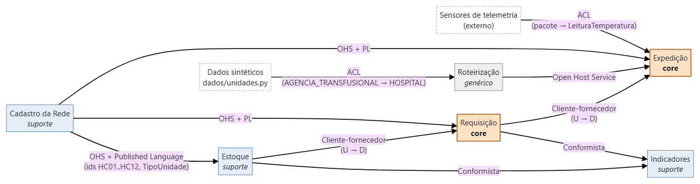
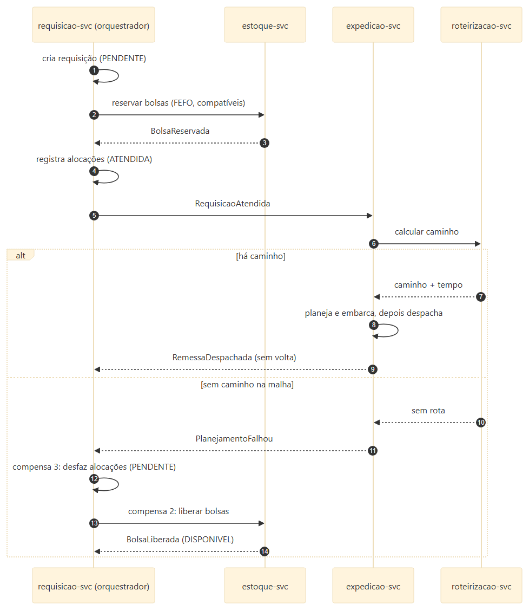
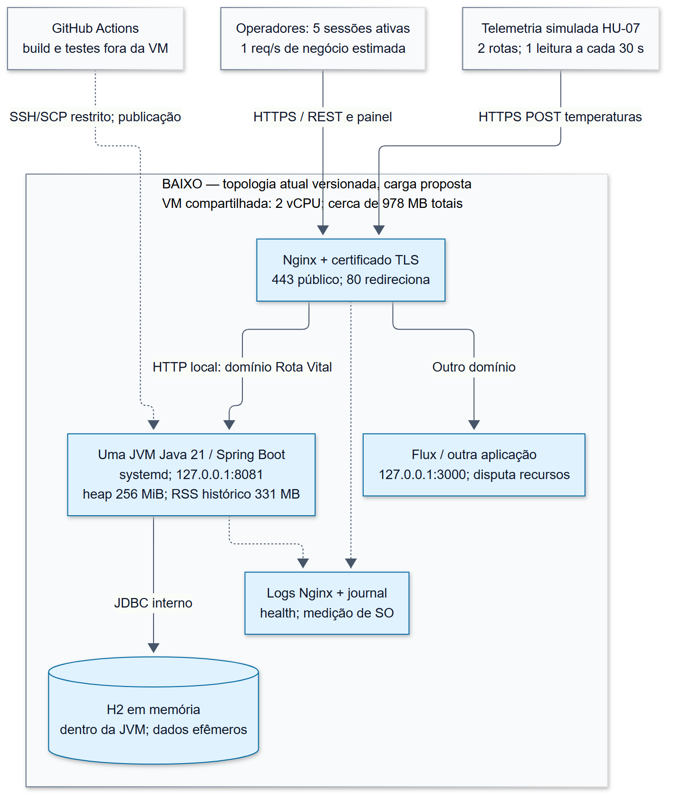
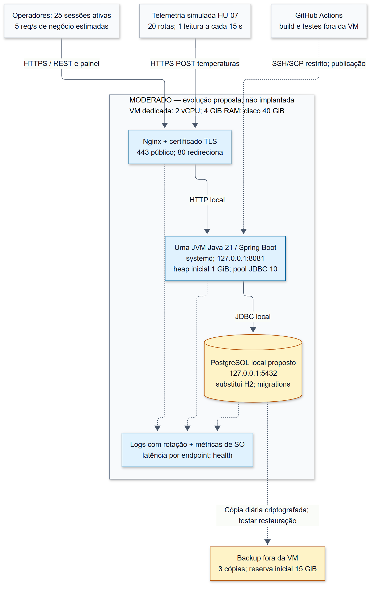
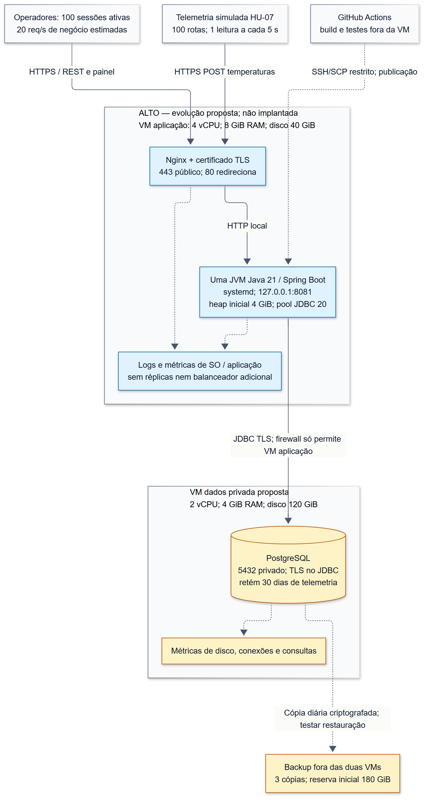

# Rota Vital: planejamento da remodelagem (Trabalho U2, Parte 2)

**Infraestrutura de Software · ADS · CESAR School · 2026.2**
**Squad:** Rota Vital (Projeto Integrador 3)
**Integrantes:** Cauã Rego Tavares Leite Duarte, Fernando Andrade Leandro Peixoto, Gabriel Brito Ferreira Dias, Guilherme Alves de Souza, Lucas Ferreira Torres de Albuquerque, Maria Eduarda Vasconcelos, Renato Santos Chong, Victor Barros Roma
**Repositório:** https://github.com/rsc3-pixel/Projeto3-2026.2 · **Aplicação no ar:** https://rsc3-rotavital.duckdns.org
**Data:** 24/11/2026

O Rota Vital controla a distribuição de hemocomponentes na Região Metropolitana do Recife: o hemocentro registra bolsas, o hospital pede, o sistema aloca a bolsa compatível que vence primeiro (FEFO) e a remessa segue em rota com a temperatura monitorada. A Parte 1 colocou o sistema em container, com TDD e esteira de CI/CD. Este documento é o plano para remodelá-lo com DDD e três camadas, e projeta como ele ficaria com microsserviços. Parte do plano já foi materializada em 24/11 (PR #115): ela aparece marcada como **feito** e serve de evidência.

---

## A. Remodelagem do domínio com DDD

### A.1 Subdomínios

| Subdomínio | Tipo | Justificativa |
|---|---|---|
| Alocação de hemocomponentes | **Core** | É o que diferencia o Rota Vital: casar a bolsa certa com o pedido certo (compatibilidade ABO/Rh por componente e FEFO) é o que evita transfusão errada e descarte por vencimento. |
| Expedição com cadeia fria | **Core** | Entregar dentro do prazo da prioridade e com a temperatura na faixa de cada componente é a outra metade do valor; nenhum produto pronto faz isso para este caso. |
| Estoque de bolsas | Suporte | Necessário e específico (validade por componente, rastreio), mas é registro e consulta: não é onde está a vantagem. |
| Cadastro da rede | Suporte | Hemocentros e hospitais com CNPJ, CNES e endereço; específico do negócio, porém simples. |
| Indicadores | Suporte | Leitura agregada para decisão (descarte evitável, cobertura); depende dos outros e não altera nada. |
| Roteirização na malha | Genérico | Caminho mínimo é problema resolvido (Dijkstra); poderia ser trocado por uma API de mapas sem mudar o negócio. |
| Identidade e acesso | Genérico | Login e perfis seriam comprados ou adotados (OAuth/OIDC); ainda não implementado. |

### A.2 Bounded contexts

| Contexto | Responsabilidade (uma frase) |
|---|---|
| **Cadastro da Rede** | Mantém as unidades (hemocentros e hospitais) e o vocabulário que as identifica para todos os outros. |
| **Estoque** | Registra cada bolsa coletada e responde, em cada momento, quais estão disponíveis, reservadas ou descartadas. |
| **Requisição** | Recebe o pedido do hospital e decide quais bolsas o atendem, garantindo compatibilidade, validade e quantidade. |
| **Expedição** | Planeja a remessa, embarca as bolsas alocadas, acompanha a viagem e a temperatura até a entrega. |
| **Roteirização** | Calcula o caminho e o tempo entre unidades da malha, sem conhecer bolsas nem pedidos. |
| **Indicadores** | Produz a visão gerencial (estoque, descarte, risco de desabastecimento) a partir dos fatos dos outros contextos. |

### A.3 Glossário da linguagem ubíqua

| Termo | Contexto | Significado |
|---|---|---|
| **Bolsa** | Estoque | Unidade física de hemocomponente com código de rastreio, coleta, validade e status (DISPONIVEL, RESERVADA, DESCARTADA). Interessa onde está e quando vence. |
| **Bolsa** | Requisição | Candidata a doadora: o que importa é grupo sanguíneo, componente e validade, para decidir se atende o receptor. |
| **Bolsa** | Expedição | Item de carga: interessa a faixa de temperatura do componente e o destino; validade e grupo já foram decididos antes. |
| **Unidade** | Cadastro da Rede | Hemocentro ou hospital, com CNPJ ou CNES e endereço. |
| **Unidade** | Roteirização | Vértice da malha, identificado pelo id (HC01 a HC12) e coordenadas; não tem CNPJ nem endereço. |
| Hemocomponente | Estoque | Hemácias, plasma, plaquetas ou crioprecipitado; define validade em dias e faixa de temperatura. |
| Requisição | Requisição | Pedido de um hospital, com prioridade (ROTINA, URGENTE, EMERGENCIA) e prazo derivado dela. |
| Item | Requisição | Linha da requisição: componente, grupo do receptor e quantidade solicitada. |
| Alocação | Requisição | Vínculo entre uma bolsa e um item, que reserva a bolsa. |
| Compatível | Requisição | A bolsa (doadora) pode ser transfundida no receptor pela tabela do componente; não significa grupo idêntico. |
| FEFO | Estoque e Requisição | First Expired, First Out: entre as compatíveis, sai primeiro a que vence antes. |
| Rota (remessa) | Expedição | Viagem de um hemocentro a um hospital levando bolsas embarcadas. |
| Excursão de temperatura | Expedição | Leitura fora da faixa de algum componente embarcado. |
| Caminho mínimo | Roteirização | Sequência de unidades de menor tempo total entre origem e destino. |
| Descarte evitável | Indicadores | Bolsa vencida que teve pedido compatível enquanto ainda valia. |

"Bolsa" e "Unidade" mudam de sentido conforme o contexto. Por isso, numa decomposição física, cada contexto teria o seu modelo de bolsa, com os atributos de que precisa, ligados pelo código de rastreio.

### A.4 Mapa de contextos



| Relação (upstream → downstream) | Padrão | Como funciona |
|---|---|---|
| Estoque → Requisição | Cliente-fornecedor | A Requisição consulta as bolsas disponíveis e pede a reserva; o Estoque decide se a transição é permitida. |
| Requisição → Expedição | Cliente-fornecedor | A Expedição só embarca bolsas que a Requisição já alocou (RESERVADA). |
| Roteirização → Expedição | Open Host Service | A Roteirização expõe "calcular rota" com contrato estável; a Expedição usa o resultado (caminho e tempo). |
| Cadastro da Rede → todos | Open Host Service + Published Language | Ids das unidades (HC01 a HC12) e o tipo `TipoUnidade` são a linguagem publicada que todos usam. |
| Sensores de telemetria → Expedição | **Camada anticorrupção (ACL)** | O pacote do sensor (temperatura, GPS, horário) é traduzido em `LeituraTemperatura`; o modelo do sensor não entra no domínio. |
| Dados sintéticos (Python) → Roteirização | **Camada anticorrupção (ACL)** | `dados/unidades.py` chama o hospital de AGENCIA_TRANSFUSIONAL; a tradução para HOSPITAL fica na borda (`UnidadeRede`), **feito em 24/11**. |
| Estoque e Requisição → Indicadores | Conformista | Indicadores lê os modelos dos outros como estão, sem negociar mudanças. |

### A.5 Eventos de domínio (opcional)

| Evento | Publica | Consome |
|---|---|---|
| BolsaRegistrada | Estoque | Indicadores |
| BolsaReservada / BolsaLiberada | Estoque | Requisição, Indicadores |
| RequisicaoCriada | Requisição | Indicadores |
| RequisicaoAtendida | Requisição | Expedição, Indicadores |
| RemessaDespachada / RemessaEntregue | Expedição | Estoque, Requisição, Indicadores |
| ExcursaoDetectada | Expedição | Indicadores (alerta) |
| BolsaVencida | Estoque | Indicadores |

Hoje existe um evento implementado, `BolsaAlterada`, publicado após o commit e consumido pelo índice de estoque em memória.

---

## B. Modelo tático do contexto core: o agregado Requisição

**Feito em 24/11** (código em `dominio/Requisicao.java`, testes em `RequisicaoTest`).

| Elemento | No modelo |
|---|---|
| Raiz | `Requisicao`: única porta de entrada; nenhum código de fora altera itens, alocações ou status. |
| Entidades | `ItemRequisicao` (componente, grupo do receptor, quantidade solicitada e alocada, `@Version`), `Alocacao` (bolsa + item + data-hora). |
| Objetos de valor | `PrioridadeRequisicao` (carrega o prazo em horas), `GrupoSanguineo`, `TipoHemocomponente`, `StatusRequisicao`. |
| Referência a outro agregado | `Alocacao.bolsa` aponta para a `Bolsa`, raiz do agregado de Estoque, que decide sozinha se pode ser reservada. |

Invariantes que a raiz protege:

| # | Invariante | Onde é garantida |
|---|---|---|
| I1 | Um item nunca recebe mais bolsas do que pediu. | `Requisicao.alocar` → `ItemRequisicao.exigirPendente` |
| I2 | Só entra bolsa disponível, na validade, do mesmo componente e de grupo **compatível** com o receptor. | `Bolsa.exigirQuePodeAtender` (regra única) |
| I3 | O status deriva das alocações; ninguém o atribui de fora. | `recalcularStatus` privado; sem `setStatus` |
| I4 | Requisição cancelada não aceita alteração. | `Requisicao.exigirAberta` |
| I5 | O cancelamento é recusado se alguma bolsa já foi despachada. | `Requisicao.cancelar` |
| I6 | Duas alocações simultâneas não perdem a contagem. | `@Version` + `AlocacaoComRepeticao` |

### História âncora (ligada às invariantes I1 e I2)

**Persona:** Marina, técnica de hemoterapia do Hemope, atende os pedidos dos hospitais durante o plantão. Ela não pode errar a compatibilidade, e não quer deixar vencer bolsa que serviria para alguém.

> **Como** técnica do hemocentro, **quero** alocar a um item da requisição uma bolsa compatível com o receptor, **para** atender o hospital sem risco transfusional e sem desperdício.

Critérios de aceite:

1. Um item que pede hemácias para um receptor A+ aceita uma bolsa O- (doadora compatível, não idêntica). (I2)
2. Uma bolsa AB+ para um receptor O- é recusada com a mensagem "Grupo sanguíneo incompatível" e continua DISPONIVEL. (I2)
3. Um item que pede 2 bolsas, depois de receber 2, recusa a terceira com "Item já está totalmente atendido". (I1)
4. Uma bolsa vencida é recusada, mesmo sendo compatível. (I2)

### Cenário Gherkin

O arquivo completo, com os quatro critérios, está em [alocacao-compativel.feature](alocacao-compativel.feature) e será executado com Cucumber na Parte 3. Os mesmos casos já rodam hoje como testes JUnit em `RequisicaoTest` e `BolsaTest`.

```gherkin
# language: pt
Funcionalidade: Alocar bolsa compatível a um item da requisição

  Cenário: Bolsa O- atende receptor A+
    Dado uma requisição URGENTE do hospital HC05 com um item de 2 bolsas de CONCENTRADO_HEMACIAS para receptor A+
    E uma bolsa "B-1" de CONCENTRADO_HEMACIAS O- disponível no hemocentro HC01, dentro da validade
    Quando a técnica alocar a bolsa "B-1" ao item
    Então a bolsa "B-1" fica RESERVADA
    E a requisição fica PARCIALMENTE_ATENDIDA
```

---

## C. Arquitetura em três camadas

### C.1 As três camadas lógicas

| Camada | O que fica nela no Rota Vital |
|---|---|
| **Apresentação** | Controllers REST (`/api/v1/...`), páginas Thymeleaf, o front-end Angular, DTOs de entrada e saída, tradução de exceções em HTTP. |
| **Negócio** | Casos de uso da aplicação (alocar, cancelar, embarcar, registrar leitura) e o modelo de domínio: entidades ricas, objetos de valor, invariantes, contratos de repositório. |
| **Dados** | Implementações dos repositórios (Spring Data JPA), o banco (H2 hoje, PostgreSQL nos cenários moderado e alto) e integrações externas (telemetria). |

### C.2 Regra de dependência

Cada camada só usa a de baixo: apresentação → negócio → dados. Dentro do negócio, o domínio não depende de controller, de banco nem de framework web; a camada de dados implementa as interfaces que o domínio declara (inversão de dependência).

Situação depois do PR #115 (24/11):

- **Atendido:** entidades com comportamento (sem `setStatus`), regras de transição e elegibilidade no domínio, exceções de negócio no domínio, serviços finos.
- **Desvio declarado (ADR 0002):** as entidades ainda carregam anotações JPA e os contratos de repositório estendem `JpaRepository`; a aplicação ainda recebe DTOs da apresentação. A Parte 3 remove os três.

### C.3 Estrutura de pacotes proposta (por contexto e por camada)

```
com.rotavital
├── cadastro
│   ├── apresentacao  (HemocentroController, HospitalController)
│   ├── negocio
│   │   ├── aplicacao (CadastrarUnidade, ServicoDeUnidade)
│   │   └── dominio   (Local, Hemocentro, Hospital, Endereco, TipoUnidade, UnidadeRepository)
│   └── dados         (HemocentroRepositoryJpa, HospitalRepositoryJpa)
├── estoque
│   ├── apresentacao  (BolsaController, EstoqueWebController)
│   ├── negocio
│   │   ├── aplicacao (RegistrarBolsa, ConsultarBolsasEmRisco, IndiceEstoque)
│   │   └── dominio   (Bolsa, StatusBolsa, Validade, BolsaRepository)
│   └── dados         (BolsaRepositoryJpa)
├── requisicao
│   ├── apresentacao  (RequisicaoController)
│   ├── negocio
│   │   ├── aplicacao (AlocarBolsa, AlocarAutomaticamente, CancelarRequisicao)
│   │   └── dominio   (Requisicao, ItemRequisicao, Alocacao, PrioridadeRequisicao,
│   │                  MatrizCompatibilidade, SelecaoFefo, RequisicaoRepository)
│   └── dados         (RequisicaoRepositoryJpa)
├── expedicao
│   ├── apresentacao  (RotaController, TelemetriaController)
│   ├── negocio
│   │   ├── aplicacao (PlanejarRota, DespacharRota, RegistrarLeitura)
│   │   └── dominio   (Rota, StatusRota, LeituraTemperatura, RotaRepository)
│   └── dados         (RotaRepositoryJpa, TelemetriaAcl)
├── roteirizacao
│   └── negocio       (Grafo, Dijkstra, VizinhoMaisProximo, CarregadorMalha)
├── indicadores
│   ├── apresentacao  (IndicadorController)
│   └── negocio       (IndicadorServico, ModeloDemanda)
└── compartilhado     (GrupoSanguineo, TipoHemocomponente, excecoes de negocio)
```

`compartilhado` é o núcleo compartilhado (shared kernel): grupo sanguíneo e hemocomponente são usados por Estoque, Requisição e Expedição com o mesmo sentido.

### C.4 Camada lógica × tier físico

| Tier físico | Onde roda | Camadas lógicas nele |
|---|---|---|
| Cliente | Navegador do operador | Parte da apresentação (Angular, que chama a API) |
| Servidor web | VM Google Compute Engine (us-west1), Nginx com TLS | Arquivos estáticos do front-end; proxy reverso para a JVM |
| Servidor de aplicação | Mesma VM, uma JVM Spring Boot | Apresentação (REST e Thymeleaf), negócio e o código da camada de dados |
| Banco | Hoje **dentro da JVM** (H2 em memória); moderado: PostgreSQL na mesma VM; alto: PostgreSQL em VM própria | Dados |

As três camadas lógicas existem no código, mas hoje rodam em um ou dois tiers: o H2 em memória faz o banco viver no mesmo processo. Só o cenário alto separa a camada de dados em outro tier.

---

## D. Projeção com microsserviços

### D.1 Serviços, comunicação e dados

| Serviço | Contexto | Por que seria um serviço | Banco |
|---|---|---|---|
| estoque-svc | Estoque | Muitas leituras (painéis, índice FEFO) e regra de status própria. | PostgreSQL próprio |
| requisicao-svc | Requisição | Core: concentra as invariantes de alocação e muda em ritmo próprio. | PostgreSQL próprio |
| expedicao-svc | Expedição + telemetria | Carga diferente: no cenário alto, 20 leituras/s de sensores contra 20 req/s de negócio. | PostgreSQL próprio (séries de leitura) |
| cadastro-svc | Cadastro da Rede | Pouca escrita; publica os ids das unidades. | PostgreSQL próprio |
| roteirizacao-svc | Roteirização | Sem estado de negócio; escala só por CPU. | Nenhum (malha em memória) |
| indicadores-svc | Indicadores | Só leitura; montado por eventos (modelo de leitura). | Banco de leitura próprio |

**Comunicação:** REST síncrono para consultas que precisam de resposta imediata (Requisição pergunta ao Estoque as bolsas compatíveis; Expedição pergunta à Roteirização o caminho). Eventos assíncronos numa fila (Pub/Sub ou RabbitMQ) para fatos que outros precisam saber (BolsaReservada, RequisicaoAtendida, RemessaDespachada). **Dados:** um banco por serviço; nenhum serviço lê a tabela de outro. A transação que hoje altera requisição e bolsa juntas vira uma saga.

### D.2 Saga "Atender requisição" (orquestrada pela Requisição)



| Passo | Serviço | Ação | Compensação se um passo seguinte falhar |
|---|---|---|---|
| 1 | requisicao-svc | Cria a requisição (PENDENTE) | Cancela a requisição |
| 2 | estoque-svc | Reserva as bolsas escolhidas (BolsaReservada) | Libera as bolsas (BolsaLiberada) |
| 3 | requisicao-svc | Registra as alocações; status ATENDIDA | Desfaz as alocações; status volta a PENDENTE |
| 4 | expedicao-svc | Planeja a rota (pede caminho à Roteirização) e embarca | Cancela a rota planejada |
| 5 | expedicao-svc | Despacha (RemessaDespachada) | Ponto sem volta: a bolsa saiu; falhas daqui em diante são tratadas na entrega |

**Falha exemplo:** no passo 4 não existe caminho na malha (o código atual já recusa o planejamento com "Nao ha rota disponivel para este destino"). A orquestração dispara as compensações 3 e 2 na ordem inversa: a requisição volta a PENDENTE e as bolsas voltam a DISPONIVEL para outro pedido. Se no passo 2 outra requisição reservou a mesma bolsa antes (conflito), a Requisição escolhe a próxima candidata por FEFO; sem candidata, fica PARCIALMENTE_ATENDIDA.

### D.3 Serverless (opcional)

| Viraria função | Motivo |
|---|---|
| Processar leitura de telemetria | Acionada por evento, curta, sem estado; escala com o número de rotas e para em zero fora do horário. |
| Emitir a guia de remessa quando a requisição é atendida | Acionada pelo evento RequisicaoAtendida; gera um PDF e termina. |

| Não viraria função | Motivo |
|---|---|
| Alocação | Transação com bloqueio otimista e repetição; abriria muitas conexões curtas com o banco. |
| Índice de estoque em memória | É estado mantido entre requisições; uma função fria o reconstruiria a cada chamada (cold start). |
| Roteirização | A malha é carregada uma vez e reaproveitada; recarregar a cada chamada custa mais do que o cálculo. |

### D.4 Comparação para o Rota Vital

| Critério | Monolito modular | Microsserviços | Serverless |
|---|---|---|---|
| Unidade de deploy | Um JAR; um deploy publica tudo | Um por serviço; deploys independentes | Uma por função |
| Escala | A aplicação inteira junta | Cada serviço no seu ritmo (ex.: só expedição) | Automática por evento, até zero |
| Consistência dos dados | Transação ACID entre agregados | Eventual, com sagas e compensação | Eventual; conexões ao banco viram gargalo |
| Custo (cenários deste documento) | US$ 12,65 a 234,15/mês (seção E) | Pelo menos 6 processos, fila e 4 bancos: várias vezes o valor | Barato em baixa carga; imprevisível no alto |
| Complexidade de operação | Baixa: um processo, um log, um banco | Alta: rede, observabilidade distribuída, versionamento de contratos | Média: menos servidor, mais configuração e depuração por evento |

### D.5 ADRs

- [ADR 0001: decomposição do Rota Vital](adr/0001-decomposicao.md): monolito modular por bounded context agora; extrair só a Expedição/telemetria quando o cenário alto for medido.
- [ADR 0002: anotações JPA nas entidades de domínio](adr/0002-jpa-no-dominio.md): desvio temporário e consciente da regra de dependência.

---

## E. Três cenários com orçamento

### E.1 Premissas de carga

"Pedido" é uma requisição de hospital. Nos dados sintéticos do Rota Vital há 300 requisições em 61 dias (19/07 a 17/09/2026), cerca de **5 pedidos/dia**: é o cenário baixo. Os outros escalam com o número de operadores e de rotas.

| Premissa | Baixo | Moderado | Alto |
|---|---:|---:|---:|
| Usuários (operadores ativos ao mesmo tempo) | 5 | 25 | 100 |
| Pedidos por dia | 5 | 50 | 500 |
| Rotas em trânsito com telemetria | 2 | 20 | 100 |
| RPS sustentado (negócio + telemetria) | 1,07 | 6,33 | 40,00 |
| **Pico de RPS** (rajada de 1 s) | **4** | **30** | **140** |
| Disponibilidade desejada | 95% (demonstração) | 99% (~7 h fora/mês) | 99,5% (~3,6 h fora/mês) |

Ressalva: nenhum cenário tem redundância (uma VM de aplicação e um banco são pontos únicos de falha). Os 99,5% do alto dependem do SLA de instância única do provedor e de restaurar o backup dentro do tempo; passar disso exige réplica, que não está orçada.

As fórmulas (2 chamadas por ação do operador, uma ação a cada 10 s, leituras por rota) estão em [so-u2-cenarios-dimensionamento.md](../so-u2-cenarios-dimensionamento.md), seção 2.1.

### E.2 Lei de Little no pico

`L = λ × W`: requisições em atendimento ao mesmo tempo = taxa de chegada × tempo que cada uma fica dentro do sistema.

**Valor de W.** No benchmark (PI3-113), o p50 visto do Recife foi 204,8 ms, mas 201,6 ms são só a ida e volta da rede até Oregon: **a aplicação gasta cerca de 3 ms**. Para dimensionar usamos **W = 0,2 s**, o tempo de ponta a ponta, que é 60 vezes o tempo do servidor e cobre conexões HTTP lentas mantidas abertas. Para o banco usamos **W_bd = 20 ms** por chamada, premissa a medir na Parte 3.

| Conta | Baixo | Moderado | Alto |
|---|---:|---:|---:|
| λ no pico (req/s) | 4 | 30 | 140 |
| L = λ × 0,2 s (requisições simultâneas) | 0,8 | 6 | 28 |
| Instâncias: threads por JVM = 200 (padrão do Tomcat), CPU no pico = 0,12 / 0,7 / 3,0 núcleos | **1** | **1** | **1** (4 vCPU) |
| L_bd = λ × 0,02 s (conexões em uso) | 0,08 | 0,6 | 2,8 |
| Conexões no pool (L_bd × 2 de folga, mínimo 5) | **5** | **5** | **6** |

Little mostra que **uma instância basta nos três cenários**: no alto são 28 requisições simultâneas contra 200 threads, e o limite real é a CPU (3 núcleos no pico, numa VM de 4). O pool de 10 e 20 conexões previsto antes estava superdimensionado; ficam 5 e 6, revisáveis com a medição. Uma segunda instância só se justifica por disponibilidade, e exige banco compartilhado (com H2, as duas teriam estoques diferentes).

### E.3 Diagramas e o que muda entre os cenários

| Baixo | Moderado | Alto |
|---|---|---|
|  |  |  |

- **Baixo → moderado:** sai da VM compartilhada para uma VM dedicada (2 vCPU, 4 GiB) e troca o H2 em memória por PostgreSQL local com backup diário. O motivo é durabilidade: 30 dias de retenção não cabem num banco que some ao reiniciar.
- **Moderado → alto:** o banco vai para uma VM própria (2 vCPU, 4 GiB, 120 GiB), e a aplicação sobe para 4 vCPU e 8 GiB. O motivo são 17,3 milhões de leituras de temperatura retidas disputando I/O e memória com a JVM.

### E.4 Orçamento por cenário

Preços on-demand, em dólar, do Google Cloud, região us-west1 (Oregon), consultados em **19/10/2026** nas páginas oficiais de preço; 730 h/mês. Planilha completa, item a item com fonte: [orcamento-cenarios.csv](orcamento-cenarios.csv).

| Item | Qtd/mês | Preço unitário (USD) | Baixo | Moderado | Alto | Fonte |
|---|---|---|---:|---:|---:|---|
| VM e2-micro (baixo) | 730 VM-h | 0,008376 /h | 6,11 | | | Compute pricing |
| VM aplicação e2-custom (moderado 2 vCPU/4 GiB; alto 4/8) | 730 h | 0,022902 /vCPU-h · 0,003070 /GiB-h | | 42,40 | 84,80 | Compute pricing |
| VM do banco e2-custom 2 vCPU/4 GiB (alto) | 730 h | idem | | | 42,40 | Compute pricing |
| Disco (pd-standard no baixo; pd-balanced) | 20 a 160 GiB | 0,000055 / 0,000137 por GiB-h | 0,80 | 4,00 | 16,00 | Disk pricing |
| IPv4 público | 730 IP-h | 0,005 /h | 3,65 | 3,65 | 3,65 | Network pricing |
| Backup no Cloud Storage (cópias, soft delete, operações) | 15 a 180 GiB | 0,000027 /GiB-h | | 1,05 | 12,05 | Storage pricing |
| Saída de dados para os usuários | 11 a 396 GiB | 0,19 /GiB | 2,09 | 11,97 | 75,24 | Network pricing |
| **Total mensal** | | | **12,65** | **63,07** | **234,15** | |
| Pedidos por mês (pedidos/dia × 30) | | | 150 | 1.500 | 15.000 | |
| **Custo por pedido** | | | **US$ 0,084** | **US$ 0,042** | **US$ 0,016** | |

O custo por pedido cai com a escala porque a maior parte do custo é fixa (VM, disco, IP). No alto, a saída de dados vira o maior item variável. Os totais não incluem impostos, créditos nem franquia gratuita; o detalhamento está em [so-u2-orcamento-mensal.md](../so-u2-orcamento-mensal.md).

---

## Uso de IA

Conforme a PO-CESAR-021 (categoria Condicionado).

| Ferramenta | Finalidade | Como foi validado |
|---|---|---|
| Claude Code (Anthropic) | Diagnóstico do código (regras duplicadas, entidades anêmicas), proposta e implementação da refatoração da Parte 3 já iniciada (PR #115), redação deste documento e dos ADRs | Código: 549 testes automatizados passando, cobertura medida com JaCoCo e esteira de CI verde até o deploy. Documento: cada afirmação sobre o código aponta para o arquivo; o squad revisou o texto antes da submissão. |
| (mesma) | Contas da seção E | As premissas de carga vêm do documento de dimensionamento do squad; as latências vêm do benchmark medido (PI3-113); os pedidos por dia vêm dos dados sintéticos do Rota Vital. Nenhum preço foi sugerido por IA: todos foram consultados nas páginas oficiais do Google Cloud em 19/10/2026 e estão com a fonte na planilha. |

Foram usados apenas os dados sintéticos do Rota Vital.
