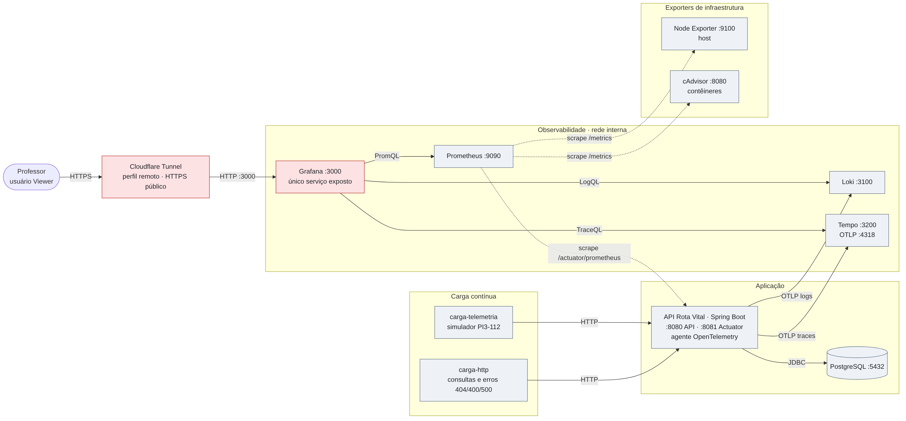

# Observabilidade: Actuator, Prometheus, Grafana, Loki e Tempo

Projeto de Avaliação de Infraestrutura de Comunicação. O Rota Vital publica:

- **métricas** pelo Spring Boot Actuator (Micrometer), coletadas pelo **Prometheus**;
- **logs** no **Loki** e **traces** no **Tempo**, correlacionados pelo `trace_id`.

Tudo é visto no **Grafana**. Node Exporter e cAdvisor cobrem o host e os contêineres. O ambiente inteiro sobe com um
único `docker compose up -d`.

> **Projeto acadêmico.** Dados sintéticos (LGPD). A telemetria de temperatura e GPS é **simulada** (PI3-112), sem
> sensor nem veículo real. As faixas de cadeia fria e a compatibilidade ABO/Rh são didáticas.

**O Rota Vital tem uma aplicação web Java** (a API Spring Boot). Os frontends Angular e React não são Java e ficam
fora do escopo do enunciado. "Todas as aplicações", aqui, é esta. Para coletar outra, basta copiar o job
`rota-vital` do `prometheus.yml`.

## 1. Onde cada requisito está

| Requisito | Onde está | Evidência para o PDF (§ 10) |
|---|---|---|
| **R1** Actuator + Prometheus, `health,info,metrics,prometheus`, tag `application` | `pom.xml`; `application-docker.properties`; `ConfiguracaoMetricas` | `curl` do `/actuator/prometheus` mostrando `application="rota-vital"` |
| **R2** HTTP, JVM, CPU, uptime, HikariCP | Automático no Spring Boot; histograma em `application.properties` | Dashboard de aplicação, seções HTTP e JVM |
| **R3** Node Exporter e cAdvisor | `compose.yaml` (`node-exporter`, `cadvisor`) | *Status → Targets* |
| **R4** Prometheus + Grafana no compose, datasources provisionados, 2 dashboards | `compose.yaml`; `observabilidade/` | Targets UP; prints dos dois dashboards |
| **R5** `/actuator` fora da internet; senha do Grafana trocada; `.env` fora do git | Porta de gestão 8081 só na rede interna; `.env.example` | § 8 |
| **R6** Loki + Tempo, `trace_id` no log, navegação log → trace | Agente OpenTelemetry na imagem; `datasources.yml` | LogQL no *Explore*; trace aberto; clique log → trace |
| **R7** Grafana remoto com usuário Viewer | Serviço `tunel` (perfil `remoto`); `grafana-usuarios` | URL + login do Viewer (só no PDF) |
| **Adicional** métricas de negócio | `MetricasDominio`, `MetricasEstoque` (§ 5) | Código + métrica no Prometheus + painel |

A estrutura sugerida no enunciado (`prometheus/`, `loki/`, `tempo/`, `grafana/`) está dentro de `observabilidade/`,
para não se misturar com o código da aplicação na raiz do repositório.

## 2. Arquitetura



Fonte do diagrama: [`diagramas/arquitetura-observabilidade.mmd`](diagramas/arquitetura-observabilidade.mmd).

| Serviço | Imagem | Porta | Publicada no host? |
|---|---|---|---|
| `api` | build do `Dockerfile` | 8080 (API) / 8081 (Actuator) | 8080 sim; 8081 só em `127.0.0.1` |
| `banco` | `postgres:17-alpine` | 5432 | não |
| `prometheus` | `prom/prometheus:v3.5.0` | 9090 | só `127.0.0.1` |
| `grafana` | `grafana/grafana:12.1.0` | 3000 | só `127.0.0.1`, e pelo túnel |
| `loki` | `grafana/loki:3.5.9` | 3100 | não |
| `tempo` | `grafana/tempo:2.8.4` | 3200, OTLP 4318/4317 | não |
| `node-exporter` | `prom/node-exporter:v1.8.2` | 9100 | não |
| `cadvisor` | `gcr.io/cadvisor/cadvisor:v0.49.1` | 8080 | não |
| `carga-telemetria` | `python:3.12-alpine` | — | — |
| `carga-http` | `curlimages/curl:8.15.0` | — | — |
| `grafana-usuarios` | `curlimages/curl:8.15.0` | — (passo único) | — |
| `tunel` (perfil `remoto`) | `cloudflare/cloudflared:2025.8.1` | — | URL HTTPS pública só do Grafana |

Todas as imagens têm versão fixa, para que o ambiente suba igual em qualquer máquina e em qualquer dia.

## 3. Como subir

**Pré-requisitos:** Docker com Compose v2 e cerca de 3 GB de memória livre para os contêineres.

```bash
cp .env.example .env          # troque TODAS as senhas (banco, admin do Grafana, Viewer)
docker compose up -d --build
docker compose ps             # tudo running/healthy; tempo-init e grafana-usuarios saem com 0
```

| Serviço | URL | O que verificar |
|---|---|---|
| Grafana | <http://localhost:3000> | Entre como `admin` (senha do `.env`). Pasta **Rota Vital**: dashboards de aplicação e de infraestrutura |
| Prometheus | <http://localhost:9090/targets> | Os 7 jobs em **UP** |
| Métricas da API | <http://localhost:8081/actuator/prometheus> | `rotavital_*` e `http_server_requests_*` com `application="rota-vital"` |
| API | <http://localhost:8080/api/v1/hemocentros> | A aplicação em si |

A carga contínua começa sozinha, então os gráficos têm dados em poucos minutos. Para parar só a carga:
`docker compose stop carga-telemetria carga-http`.

## 4. Instrumentação da aplicação (R1, R2)

- **Dependências:** `spring-boot-starter-actuator` e `micrometer-registry-prometheus`.
- **Endpoints:** `health`, `info`, `metrics` e `prometheus`. Nenhum outro é exposto: `env`, `beans` e `configprops`
  mostrariam as variáveis de ambiente, com a senha do banco. O teste `PerfilDockerMetricasTest` quebra o build se a
  lista mudar ou se alguém usar `*`.
- **Tag `application=rota-vital`** em toda métrica, por um `MeterFilter` (`ConfiguracaoMetricas`). É API do
  Micrometer, que o Spring Boot aplica antes de criar qualquer métrica; o teste `MetricasEstoqueIntegracaoTest`
  confere a tag.
- **Histograma de latência HTTP** ligado (`percentiles-histogram.http.server.requests`), para o p95 por endpoint.
- **Porta de gestão separada** no perfil docker: API na 8080, Actuator na 8081 (ver § 8).

## 5. Métricas de negócio (adicional)

| Métrica no Prometheus | Tipo | Tags | O que mede |
|---|---|---|---|
| `rotavital_estoque_bolsas` | gauge | `tipo`, `status` | Bolsas no estoque por tipo de hemocomponente e status |
| `rotavital_estoque_vencendo` | gauge | `tipo`, `janela_dias` | Bolsas DISPONÍVEIS que vencem em até 3 dias |
| `rotavital_estoque_vencidas_disponiveis` | gauge | `tipo` | Bolsas vencidas ainda marcadas como DISPONÍVEL |
| `rotavital_telemetria_leituras_total` | counter | `resultado` | Leituras de temperatura recebidas: dentro da faixa ou excursão |
| `rotavital_telemetria_excursoes_total` | counter | `componente` | Leituras fora da faixa, por componente a bordo |
| `rotavital_alocacoes_total` | counter | `modo`, `resultado` | Alocações de bolsa: sucesso, sucesso após repetição, conflito de concorrência, recusa |
| `rotavital_alocacoes_repeticoes_total` | counter | — | Tentativas repetidas por conflito de concorrência (PI3-108) |
| `rotavital_alocacoes_duracao_seconds` | timer | `modo`, `resultado` | Tempo de uma alocação, incluindo as repetições (média e p95) |

Cada uma tem painel próprio na seção **Hemocomponentes** do dashboard de aplicação. Decisões:

- **Tags só com valores de conjunto fechado** (enum, resultado, modo), nunca id de rota ou bolsa. Cada valor distinto
  de tag é uma série nova no Prometheus.
- **Séries nascem zeradas.** O painel mostra 0 em vez de "No data", e o `increase()` não perde o primeiro evento.
- **Gauges de estoque em cache de 30 s.** As 28 séries saem de 3 consultas `GROUP BY`, e não de 28 consultas por
  coleta. Se o banco falhar, o gauge mantém o último valor.

## 6. Logs e traces (R6)

**Como os dados chegam.** A imagem da API leva o **agente do OpenTelemetry** (v2.33.1, conferido por SHA-256 no
`Dockerfile`), ligado pelo compose com `-javaagent`. Sem mudar código, ele:

- cria um **trace** por requisição, com spans de Tomcat, Spring MVC, dos serviços de domínio e de cada consulta SQL,
  e envia ao Tempo por OTLP;
- envia **cada linha de log** ao Loki por OTLP, com o `trace_id` e o `span_id` como *structured metadata*;
- põe `trace_id` e `span_id` também no log do console (`logging.pattern.correlation`).

Os spans dos serviços de domínio vêm de `OTEL_INSTRUMENTATION_METHODS_INCLUDE` no compose. Uma alocação automática,
por exemplo, aparece como `POST /api/v1/requisicoes/{id}/itens/{itemId}/alocacoes/automatica` → `RequisicaoServico.alocarAutomaticamente` → consultas
SQL.

**Como navegar no Grafana:**

1. **Log → trace.** *Explore* → Loki → `{service_name="rota-vital"} | severity_text="ERROR"`. Expanda uma linha: o
   campo `trace_id` tem o botão **Abrir trace no Tempo**.
2. **Trace → logs.** *Explore* → Tempo → busca por `{resource.service.name="rota-vital" && span.http.route=~"/api.*"}`.
   Abra um trace: o ícone de logs em cada span abre as linhas do mesmo `trace_id`.
3. **Caso de erro.** O `carga-http` chama `/api/v1/demonstracao/erro` a cada ~20 s. É um endpoint que devolve 500 e
   registra um ERROR, e só existe no perfil docker (`DemonstracaoObservabilidadeControllerTest`). Ele também gera
   404 e 400.

Consultas úteis:

| Fonte | Consulta | O que mostra |
|---|---|---|
| Loki | `{service_name="rota-vital"}` | Todos os logs da aplicação |
| Loki | `sum by (severity_text) (count_over_time({service_name="rota-vital"}[5m]))` | Volume de log por nível |
| Tempo | `{resource.service.name="rota-vital" && status=error}` | Traces com erro |
| Tempo | `{span.http.route="/api/v1/rotas/calcular"}` | Cálculo de rota (Dijkstra) |

Os traces das coletas do Prometheus (`/actuator/prometheus`, a cada 15 s) também chegam ao Tempo. Por isso as buscas
acima filtram por rota da API.

## 7. Infraestrutura (R3) e dashboards (R4)

- **Node Exporter:** CPU, memória, disco, rede e load average do host.
- **cAdvisor:** CPU, memória e rede de cada contêiner.

No **Docker Desktop (Windows/macOS)**, o "host" medido é a VM Linux do Docker, não o computador. O enunciado aceita,
desde que explicado no PDF.

| Dashboard | Arquivo | Seções |
|---|---|---|
| **Rota Vital — API e hemocomponentes** (aplicação) | `rota-vital.json` | Visão geral · Hemocomponentes (métricas de negócio) · HTTP · JVM e banco · logs de erro (Loki) |
| **Rota Vital — Infraestrutura** | `infraestrutura.json` | Alvos do Prometheus · Host · Contêineres |

O dashboard de aplicação tem a variável **Aplicação** (tag `application`).

Os JSON são **gerados** por `observabilidade/grafana/gerar_dashboards.py`, e não editados à mão. Para mudar um painel,
edite o gerador e rode `python3 observabilidade/grafana/gerar_dashboards.py`.

**Alertas** (`observabilidade/prometheus/alertas.yml`, em <http://localhost:9090/alerts>; sem Alertmanager, não
enviam nada):

- alvo fora do ar;
- 5xx acima de 1%;
- p95 acima de 500 ms;
- excursão de temperatura;
- bolsa vencida no estoque disponível;
- conflitos de alocação.

## 8. Segurança mínima (R5)

| Medida | Como |
|---|---|
| `/actuator` fora da internet | No perfil docker o Actuator escuta na **8081**, publicada só em `127.0.0.1`. O Prometheus lê pela rede interna (`api:8081`). Mesmo com a API (8080) acessível, `/actuator` não está nela |
| Prometheus, Loki, Tempo e exporters fechados | Nenhuma porta publicada, ou só em `127.0.0.1` (Prometheus) |
| Grafana sem `admin/admin` | `GF_SECURITY_ADMIN_PASSWORD` obrigatório no `.env`; o compose recusa subir sem ele |
| Sem acesso anônimo | `GF_AUTH_ANONYMOUS_ENABLED=false` e cadastro desligado. Com o túnel a URL é pública |
| Segredos fora do git | `.env` no `.gitignore`; o `.env.example` só tem nomes e valores de exemplo |
| Agente verificado | Versão fixa + SHA-256 no `Dockerfile`: o build falha se o jar baixado for outro |
| Produção inalterada | O perfil `prod` (VM) continua expondo só `health` (`PerfilProducaoTest`) |

## 9. Acesso remoto (R7)

**Solução adotada: Cloudflare Tunnel.** O contêiner `cloudflared` abre uma conexão de saída até a Cloudflare e recebe
uma URL HTTPS pública que leva **só ao Grafana**. Não é preciso abrir porta no roteador nem no firewall, é gratuito, e
o Prometheus e o `/actuator` continuam na rede interna.

A VM de produção não foi usada porque tem 978 MB compartilhados com outra aplicação (ver PI3-114).

```bash
docker compose --profile remoto up -d
docker compose logs tunel | grep -o 'https://[a-z0-9-]*\.trycloudflare\.com'
```

- **Usuário do professor:** o serviço `grafana-usuarios` cria, na subida, o usuário `GRAFANA_VIEWER_USER` com papel
  **Viewer**. Ele vê dashboards e o *Explore*, mas não edita. As credenciais vão **só no PDF/Classroom**, nunca no
  repositório.
- **Dados durante a correção:** `carga-telemetria` e `carga-http` ficam rodando.
- **URL fixa (opcional).** A URL `trycloudflare.com` muda a cada reinício do túnel. Para uma URL estável:
  1. crie um túnel nomeado no painel da Cloudflare;
  2. troque o `command` do serviço `tunel` por `tunnel --no-autoupdate run --token ${CLOUDFLARE_TUNNEL_TOKEN}`;
  3. defina `GRAFANA_ROOT_URL` com o endereço.
- **Período:** a máquina que roda o compose precisa ficar ligada, sem suspender, durante toda a janela de correção.

## 10. Roteiro de evidências para o PDF

Prints com **data e hora visíveis** (relógio do sistema na tela). Ambiente com pelo menos 15 min de carga.

| Etapa | O que capturar | Como |
|---|---|---|
| E1 | `/actuator/prometheus` com a tag | `curl -s localhost:8081/actuator/prometheus \| grep -E 'rotavital_alocacoes_total\|http_server_requests_seconds_count' \| head` |
| E2, E3 | Todos os alvos UP; ambiente no ar | <http://localhost:9090/targets>; `docker compose ps` |
| E3 | Uma consulta PromQL | Prometheus → `sum by (uri) (rate(http_server_requests_seconds_count{application="rota-vital"}[1m]))` |
| E4 | Os dois dashboards com dados | Pasta Rota Vital no Grafana |
| E5 | LogQL no *Explore* | `{service_name="rota-vital"} \| severity_text="ERROR"` |
| E6 | Trace aberto com vários spans; navegação log → trace | Botão **Abrir trace no Tempo** numa linha do E5 |
| E7 | Login com o usuário Viewer pela URL do túnel | Navegador anônimo, pela URL `trycloudflare.com` |
| Adicional | Código, métrica e painel | `MetricasDominio.java`; Prometheus → `rotavital_alocacoes_duracao_seconds_count`; seção Hemocomponentes |

## 11. Limites conhecidos

- **Uma VM, um Prometheus.** Sem alta disponibilidade da própria observabilidade; aceitável para o ambiente acadêmico.
- **Retenção curta:** 7 dias de métricas e 3 de logs e traces, para caber em disco de notebook.
- **Overhead do agente:** cerca de 100 MB de memória a mais na API e alguns segundos na subida. Por isso o compose
  usa `MaxMetaspaceSize=256m`, e não os 128 MB da VM.
