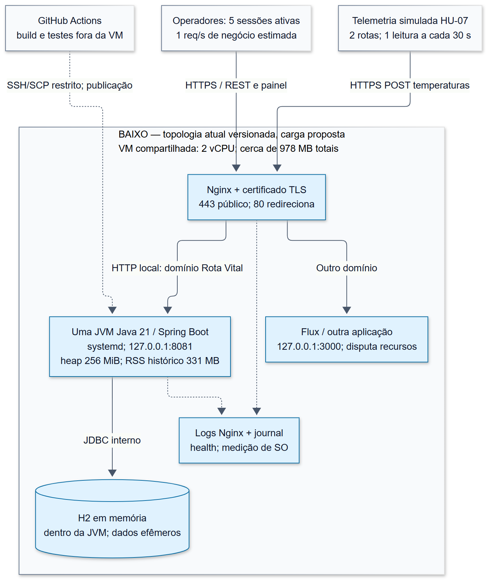
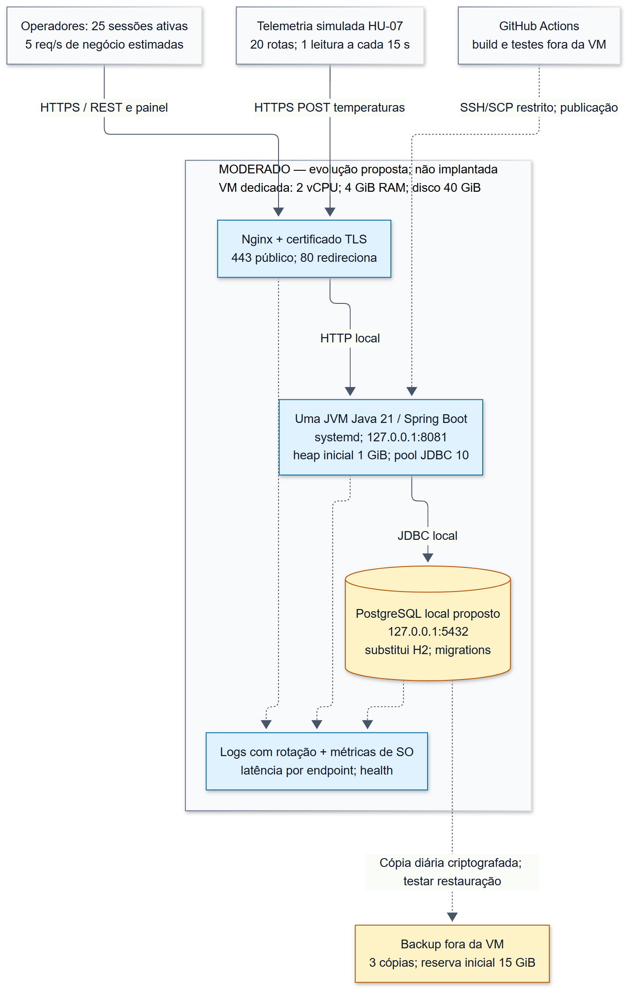
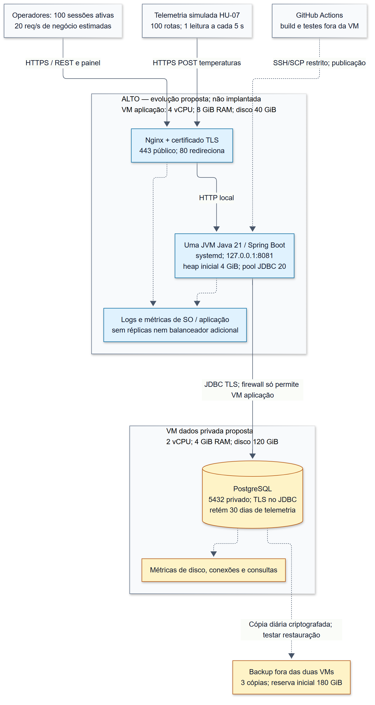

# SO U2 — Arquitetura em cenários e dimensionamento

**Rubrica:** Arquitetura em cenários + orçamento (40%), item 1.
**Data:** 19/10/2026. **Base inspecionada:** `04007e6` da `main`.

Esta entrega define cargas **estimadas** baixa, moderada e alta, apresenta três diagramas e justifica os recursos de cada cenário. O baixo conserva a topologia versionada do deploy; moderado e alto são evoluções propostas, **não implantações já realizadas**. Os dados de negócio e de temperatura do projeto são sintéticos. Nenhum teste de estresse foi executado contra a VM compartilhada.

## 1. Levantamento da arquitetura, carga e dependências

### 1.1 Evidências encontradas

| Fonte versionada | Evidência | Uso e limite no dimensionamento |
|---|---|---|
| [Perfil de produção](../src/main/resources/application-prod.properties) e [Nginx](../infra/nginx-rota-vital.conf) | Nginx encaminha ao Spring em `127.0.0.1:8081`; console H2 bloqueado; Actuator público limitado a `health` | Define a comunicação dos diagramas; `health` não mede capacidade |
| [Configuração base](../src/main/resources/application.properties) e [pom.xml](../pom.xml) | H2 em memória, Java 21; não há driver PostgreSQL declarado | Banco persistente nos cenários maiores exige implementação, não apenas mudança no desenho |
| [Provisionamento systemd](../infra/provisionar.sh) e [deploy](deploy.md) | VM compartilhada; 2 vCPU citadas no provisionamento; cerca de 978 MB totais, 577 MB disponíveis antes da JVM; heap 256 MiB e metaspace limitado a 128 MiB | Referência histórica, sem confirmação atual de CPU disponível, disco, região ou consumo dos vizinhos |
| [Deploy — memória](deploy.md) | RSS de 331 MB após 100 requisições a cinco recursos; folga estimada de 246 MB | Medição histórica relatada, sem série bruta anexada; não prova throughput, p95 ou estabilidade sob concorrência |
| [CargaInicial](../src/main/java/com/rotavital/config/CargaInicial.java) | Semente 42; 25 bolsas por hemocentro, total de 100; carga sintética executada também em produção | Massa inicial pequena; não equivale a um teste de carga HTTP |
| [Painel](../src/main/resources/static/painel.html) | Seis consultas de indicadores disparadas por `Promise.all` ao abrir a página | Uma ação visual pode gerar várias chamadas; não há polling periódico configurado nesse painel |
| [TemperaturaServico](../src/main/java/com/rotavital/servico/TemperaturaServico.java) e [RotaController](../src/main/java/com/rotavital/api/RotaController.java) | `POST /api/v1/rotas/{id}/temperaturas` grava leitura e avalia componentes; rota precisa estar `EM_TRANSITO`; histórico via GET | Telemetria simulada por HTTP; frequência e número de rotas são premissas de cenário, não frequências observadas |
| [IndicadorServico](../src/main/java/com/rotavital/servico/IndicadorServico.java) | Indicadores carregam coleções de bolsas e, na cobertura, requisições e itens | CPU e memória crescem com o volume; aumentar a VM não elimina a necessidade de revisar essas consultas |
| [Medição de alocação](W02-escopo-grafo-rede-distribuicao.md) | Microbenchmark documentado com 100 bolsas: Dijkstra ~11,5 µs; alocação ~17,1 µs | Mede algoritmo em teste; não inclui HTTP, TLS, serialização ou persistência. Não foi convertido em RPS da API |
| [Pipeline](../.github/workflows/ci.yml) | Build/teste/empacotamento no GitHub Actions; publicação por SSH/SCP; deploy somente na main | CI não consome CPU de compilação na VM de atendimento; reinício ainda pode interromper serviço |

**Divergências resolvidas para estes diagramas.** O [documento de RSD U1](evidencias-unidade-1-rsd.md) cita porta 8080 e região `us-central1`, enquanto o deploy cita `us-west1-a`. O perfil `prod`, o Nginx e o pipeline concordam em **8081 local**; essa é a porta adotada. A região e o tipo comercial da VM ficam **a confirmar**, sem inferência por um documento contraditório. Não houve acesso SSH ou inspeção da configuração efetiva da VM nesta task.

A [comparação de topologia W06](W06-topologia-diferencas.md) confirma que Redis, RabbitMQ, múltiplas réplicas e PostgreSQL eram elementos planejados, não componentes implantados. A HU-07 atual grava e responde de forma síncrona; não exige uma fila só por ser telemetria.

### 1.2 Dependências de RSD e POO

| Dependência | Disponível agora | Dado ainda necessário para homologar capacidade | Como obter |
|---|---|---|---|
| Telemetria de RSD | Contrato HTTP, lógica da HU-07, proxy e logs separados | Taxa de leituras, tamanho das mensagens, perdas/reenvios, latência e simultaneidade reais | RSD deve coletar logs do simulador e do proxy durante ensaio controlado; separar falhas de rede de rejeições de negócio |
| Carga do app — POO | Massa inicial, endpoints, painel e caminhos de consulta | Mistura de operações, custo de CPU por chamada, RSS/GC, throughput e p95 por endpoint | POO deve executar o roteiro da seção 5 em ambiente de homologação com massa sintética e registrar commit/configuração |

As dependências estão **parcialmente atendidas** pelo código e pelos registros existentes. As estimativas abaixo permitem concluir o planejamento; não substituem as medições pendentes nem autorizam declarar os cenários homologados.

## 2. Três cenários de carga estimada

### 2.1 Premissas comuns e contas

Uma sessão ativa representa um operador interagindo, não uma requisição HTTP permanentemente em execução. Adota-se uma ação a cada 10 segundos por operador: 60% consultas simples, 20% gravações de negócio e 20% aberturas do painel. As primeiras ações fazem uma chamada cada; o painel faz seis. Logo, são `0,8 × 1 + 0,2 × 6 = 2 chamadas/ação` em média, excluindo o carregamento inicial de arquivos estáticos. Na carga de negócio resultante, 30% das chamadas são consultas simples, 10% gravações e 60% indicadores.

- `RPS negócio = sessões × 2 / 10`.
- `RPS telemetria = rotas em trânsito / intervalo entre leituras`.
- `RPS total = RPS negócio + RPS telemetria`.
- Rajada de planejamento em **uma janela de 1 segundo**: dobro da taxa de negócio mais uma leitura de cada rota ao mesmo tempo. É um envelope adicional de teste, não o pico máximo possível; aberturas simultâneas de painéis devem ser testadas separadamente.
- Operação assumida: 8 horas ativas por dia. `Leituras/dia = RPS telemetria × 28.800`. Em operação 24 horas, multiplicar o volume diário por três.

São escolhas didáticas de uma demonstração, uma operação regional e uma expansão regional, respectivamente. Devem ser ajustadas quando as dependências fornecerem dados reais de uso. A frequência de leitura é uma premissa de tráfego, não uma recomendação clínica de monitoramento.

| Parâmetro | Baixo | Moderado | Alto |
|---|---:|---:|---:|
| Sessões ativas de operadores | 5 | 25 | 100 |
| Rotas em trânsito com telemetria | 2 | 20 | 100 |
| Intervalo por leitura | 30 s | 15 s | 5 s |
| RPS de negócio | 1,00 | 5,00 | 20,00 |
| RPS de telemetria | 0,07 | 1,33 | 20,00 |
| **RPS total sustentado estimado** | **1,07** | **6,33** | **40,00** |
| Rajada de 1 s para teste | 4 req/s | 30 req/s | 140 req/s |
| Massa proposta: bolsas / requisições de negócio | 100 / 30 | 2.000 / 300 | 20.000 / 3.000 |
| Leituras de temperatura por dia de 8 h | 1.920 | 38.400 | 576.000 |
| Janela de dados dimensionada | Ensaio de 1 dia, efêmero | Retenção proposta de 30 dias | Retenção proposta de 30 dias |
| Leituras nessa janela | 1.920 | 1.152.000 | 17.280.000 |

As massas incluem rotas válidas `EM_TRANSITO` com bolsas embarcadas para os POSTs de temperatura. As 30 requisições do cenário baixo são uma massa-alvo de ensaio, não uma contagem afirmada da produção. Todas as massas maiores precisam ser preparadas para teste; não estão carregadas na aplicação por esta entrega.

### 2.2 Memória de cálculo de CPU, rede e armazenamento

As contas são reproduzíveis em [dimensionamento_so_u2.py](../dados/dimensionamento_so_u2.py), com entradas e saídas em [dimensionamento-so-u2.json](../dados/dimensionamento-so-u2.json). Esse script calcula premissas; não gera tráfego ou resultados de benchmark.

**CPU da aplicação:** assume-se, para planejamento, 50 ms de CPU por chamada de negócio e 10 ms por leitura de temperatura. Não são tempos medidos e não incluem CPU do PostgreSQL/Nginx. `Núcleos consumidos = RPS negócio × 0,050 + RPS telemetria × 0,010`.

| Estimativa | Baixo | Moderado | Alto |
|---|---:|---:|---:|
| Núcleos da aplicação no regime sustentado | 0,051 | 0,263 | 1,200 |
| Núcleos da aplicação durante a rajada | 0,120 | 0,700 | 3,000 |
| Tráfego sustentado, supondo 10 KiB por troca HTTP | 0,09 Mbit/s | 0,52 Mbit/s | 3,28 Mbit/s |
| Requisições em voo, se a média de resposta for 200 ms | 0,21 | 1,27 | 8,00 |

O último indicador é `taxa × tempo médio`; não usa p95 e não determina sozinho o tamanho do pool de threads. O tráfego é uma aproximação de payload médio, sem sobrecarga de TLS/TCP, estáticos, deploy ou backup. No pico alto, a mesma conta dá **11,47 Mbit/s**. Reservar conectividade capaz de pelo menos 20 Mbit/s é uma hipótese inicial, a confirmar com payload e throughput medidos; listas sem paginação podem exceder muito os 10 KiB.

**Disco:** assume-se 1 KiB lógico por leitura e fator três para índices e folga, totalizando **3 KiB por leitura**; não é tamanho medido nem estimativa de objeto Java. Para moderado: `38.400 × 30 × 3 KiB = 3,30 GiB`. Para alto: `576.000 × 30 × 3 KiB = 49,44 GiB`. No baixo, um dia representa cerca de 5,63 MiB equivalentes, mas o H2 guarda os dados em memória e pode perdê-los antes disso ao reiniciar. Não há garantia de retenção nesse cenário.

No alto operando 24 h/dia, só a telemetria estimada sobe para **148,32 GiB/30 dias**, ultrapassando o volume de dados proposto. É obrigatório redimensionar ou rever a retenção antes de mudar o horário de operação. Remoção de leituras antigas, rotação de logs e backup periódico são propostas; não estão implementados por este documento.

## 3. Diagramas e orçamento de recursos por cenário

Nos diagramas, azul identifica papéis reaproveitados da aplicação atual; amarelo identifica componentes propostos. Os títulos marcam o que é atual e o que é evolução. Setas contínuas representam tráfego da aplicação; tracejadas representam publicação, observabilidade ou backup. Os arquivos Mermaid editáveis acompanham as imagens.

### 3.1 Baixo — conservar o monólito na VM compartilhada



[Fonte editável do diagrama baixo](diagramas/so-u2-baixo.mmd).

**Recursos:** manter a VM compartilhada descrita no deploy, com 2 vCPU compartilhadas e cerca de 978 MB de RAM total, heap de 256 MiB e metaspace de até 128 MiB. O RSS histórico de 331 MB **já inclui** heap utilizado e memória nativa; não somar novamente 256 + 128 + 331. Não há reserva garantida de CPU para o Rota Vital. Antes do ensaio, confirmar pelo menos a folga histórica de aproximadamente 246 MB e acompanhar também o Flux.

**Disco:** capacidade atual não identificada no repositório; validar no host. Como referência de provisionamento, reservar 20 GiB totais: 10 GiB para SO/pacotes, 5 GiB para JARs/logs e 5 GiB livres. Esse orçamento é para o host compartilhado e precisa incorporar os arquivos dos outros serviços; não representa espaço livre medido. H2 em memória não torna os dados persistentes por haver disco disponível.

**Por quê:** o ponto de partida já atende ao formato de demonstração, e não existe evidência que justifique mais processos. Nginx concentra TLS e encaminhamento por domínio, systemd gerencia a única JVM e H2 mantém a demonstração simples. O limite deste cenário é a memória compartilhada e a perda de dados ao reiniciar. Mesmo com pouca carga, necessidade de preservar histórico é motivo suficiente para migrar ao desenho moderado.

### 3.2 Moderado — VM dedicada e banco persistente local



[Fonte editável do diagrama moderado](diagramas/so-u2-moderado.mmd).

**Recursos propostos:** uma VM dedicada ao Rota Vital com **2 vCPU, 4 GiB RAM e 40 GiB de disco**. Manter uma JVM e Nginx; substituir H2 por PostgreSQL no mesmo host, acessível apenas em `127.0.0.1:5432`. Pool JDBC inicial de 10 conexões, a ajustar conforme espera e ocupação observadas.

| Orçamento de RAM do host | MiB |
|---|---:|
| Heap máximo inicial da JVM | 1.024 |
| Reserva nativa da JVM: metaspace, stacks, buffers e GC | 512 |
| PostgreSQL: buffers e processos, orçamento inicial | 1.024 |
| SO e Nginx | 512 |
| Folga para variações e cache do sistema | 1.024 |
| **Total** | **4.096** |

São envelopes de planejamento, não limites cgroup já aplicados. O heap de 1 GiB não cabe no host atual de aproximadamente 1 GiB: requer a VM dedicada proposta. Confirmar RSS e pausas de GC antes de alterar limites da JVM; não copiar automaticamente o teto de metaspace da demonstração.

**Disco de 40 GiB:** 20 GiB para SO/pacotes, 10 GiB para dados/índices/WAL e 10 GiB para logs, temporários e folga. A telemetria calculada ocupa cerca de 3,30 GiB, deixando margem dentro do orçamento de banco para as entidades de negócio e operações de escrita. Validar IOPS, latência de commit e ocupação de WAL; capacidade em GiB não garante velocidade.

**Backup proposto:** cópia diária criptografada fora da VM, três cópias com reserva inicial de 5 GiB cada (15 GiB). O tamanho é estimado sem pressupor compressão; medir o dump real e aumentar a reserva quando necessário. Definir janela e ensaiar restauração; RPO de até 24 h e RTO-alvo de 4 h são metas acadêmicas a validar, não garantias de disponibilidade clínica.

**Por quê:** 2 vCPU mantêm simplicidade e margem sobre a estimativa de CPU da aplicação (0,263 núcleo sustentado e 0,7 na rajada), mas também devem atender proxy, SO e banco. A memória de 4 GiB separa heap, banco e folga. A máquina dedicada elimina competição com Flux. PostgreSQL é justificado pela persistência do histórico, mesmo se o RPS permanecer baixo. Backup externo protege contra perda do host; não serve como réplica online.

**Pré-requisitos para implantar:** adicionar driver PostgreSQL, configurar credenciais fora do repositório, criar migrations, substituir `ddl-auto=create` por validação de schema e ajustar a carga sintética para não popular a produção persistente. Testar consultas/DDL com PostgreSQL e restauração. Esses passos são mudanças futuras e não foram executados nesta task.

### 3.3 Alto — separar aplicação e dados, mantendo uma JVM



[Fonte editável do diagrama alto](diagramas/so-u2-alto.mmd).

**Recursos propostos:** VM de aplicação com **4 vCPU, 8 GiB RAM, 40 GiB de disco**; VM de dados com **2 vCPU, 4 GiB RAM, 120 GiB de disco**. Total: **6 vCPU e 12 GiB RAM**, em duas VMs. Nginx e Spring continuam no mesmo host; PostgreSQL atende pelo IP privado, com TLS na conexão e firewall aceitando 5432 somente da VM de aplicação. Não abrir 8081 ou 5432 na internet. O acesso SSH de publicação/administração deve ser restrito à origem administrativa autorizada.

| Orçamento de memória | VM aplicação | VM dados |
|---|---:|---:|
| Heap Java / buffers PostgreSQL | 4 GiB | 1 GiB |
| JVM nativa / processos e memória de trabalho do banco | 1 GiB | 1 GiB |
| SO, proxy e cache de arquivos | 1 GiB | 1 GiB |
| Folga | 2 GiB | 1 GiB |
| **Total** | **8 GiB** | **4 GiB** |

O orçamento do banco deve considerar memória por consulta e conexão, não apenas buffers compartilhados. O pool JDBC começa com 20 conexões na única JVM; multiplicar conexões sem medir pode aumentar contenção e consumo de memória.

**CPU:** os 4 vCPU da aplicação correspondem a cerca de 30% de uso estimado em regime e 75% no segundo de rajada, antes do custo do proxy/SO. É uma reserva inicial, não uma capacidade comprovada. Os 2 vCPU do banco são um ponto inicial independente para commits e consultas; o custo de banco não foi medido. Se a mistura real ou as consultas excederem esses envelopes, revisar consultas e repetir o ensaio antes de aumentar recursos.

**Disco:** 40 GiB na aplicação (20 SO/pacotes, 10 JARs/logs e 10 livres). Na VM de banco, 120 GiB (50 telemetria, 10 demais dados/índices, 20 WAL/temporários, 10 SO e 30 livres). Os 50 GiB para telemetria derivam dos 49,44 GiB estimados. Backup externo: três cópias de até 60 GiB, reserva inicial de 180 GiB, condicionada à medição do dump. Backups devem ocorrer fora do pico e ter taxa controlada para não disputar I/O com a ingestão.

**Por quê:** a projeção de 17,28 milhões de leituras retidas justifica isolar I/O e memória do banco da JVM. Não justifica, sozinha, Kubernetes, cache ou mensageria. O processo Java único evita acrescentar coordenação distribuída antes de medir necessidade. As duas VMs **não constituem alta disponibilidade**: há uma instância de aplicação e uma de banco, ambas pontos únicos de falha. Se houver requisito de continuidade superior ao RTO proposto, tratar replicação/failover em dimensionamento específico.

**Condições antes de homologar:** concluir a migração persistente e a política de retenção; paginar/limitar histórico de temperatura e listagens; avaliar agregações no banco para indicadores que hoje carregam coleções inteiras; validar índices pelos planos de consulta. Confirmar proteção transacional contra dupla alocação nos testes concorrentes. A topologia alta é compatível com a evolução do monólito, mas a versão atual não está declarada capaz de suportar essa massa.

### 3.4 Inventário para orçamento e justificativa de componentes

| Item | Baixo | Moderado | Alto | Justificativa |
|---|---|---|---|---|
| Compute | VM existente compartilhada | 1 VM 2 vCPU / 4 GiB | 1 VM 4 vCPU / 8 GiB + 1 VM 2 vCPU / 4 GiB | Crescimento gradual; isolamento de aplicação e, depois, de banco |
| Discos | Referência 20 GiB; atual a confirmar | 40 GiB | 40 + 120 GiB | SO, artefatos, dados, logs e folga explicitados |
| Backup externo | Sem histórico persistente garantido | Reserva 15 GiB | Reserva 180 GiB | Cópias fora do domínio de falha das VMs persistentes |
| Nginx + TLS | Existente | Mantido | Mantido | Entrada HTTPS e proxy; não é um balanceador entre réplicas |
| systemd + JVM única | Existente | Mantido | Mantido | Deploy e operação já usados pela equipe |
| Banco | H2 na JVM | PostgreSQL local proposto | PostgreSQL privado proposto | Persistência; separação de I/O só no cenário maior |
| Observabilidade | Logs, health e SO | Acrescentar tempos por endpoint e métricas internas | Acrescentar métricas de consultas/disco do banco | Medir o gargalo sem instalar uma plataforma distribuída de monitoramento |
| CI/CD | GitHub Actions | Mesmo fluxo, alvo atualizado | Mesmo fluxo para a VM de aplicação | Reutilizar build/teste; preparar migrations antes de publicar |

Esta tabela é o **orçamento de recursos do item 1**, não uma cotação monetária. A apuração de preço exige confirmar provedor/região, tipo de disco, horas mensais, tráfego e retenção de backup. A VM atual não é considerada gratuita só por já existir: há consumo compartilhado. Não foram inventados preços, créditos ou custos mensais.

**Componentes não adicionados:** Redis (sem cache invalidável definido), RabbitMQ/Kafka (ingestão atual é síncrona e a taxa ainda deve ser medida), microsserviços/Kubernetes (monólito e poucas VMs), balanceador adicional (uma JVM), réplica de banco (sem requisito de disponibilidade que a fundamente nesta task). Reavaliar apenas com gargalo ou requisito explícito. Antes de duplicar a JVM, é obrigatório banco compartilhado e teste de consistência de alocação; duas instâncias com H2 teriam estoques independentes.

## 4. Gargalos e critérios para evoluir

Os limites abaixo são **critérios propostos para ensaio**, não alarmes já configurados nem SLAs contratados. Registrar por endpoint para não esconder alocação lenta atrás de consultas simples rápidas.

| Sinal medido | Janela/limite proposto | Decisão |
|---|---|---|
| Necessidade de preservar histórico em reinícios | Requisito funcional, mesmo com RPS baixo | Adotar persistência e backup do moderado |
| Pouca memória ou interferência na VM compartilhada | `MemAvailable` abaixo de 200 MiB por 5 min, OOM ou degradação do Flux | Interromper aumento de carga; rever heap e migrar para VM dedicada; não tirar memória do vizinho |
| CPU alta sustentada | Acima de 70% dos vCPU do host por 10 min; separar processos e observar CPU steal | Localizar JVM, banco ou vizinho responsável; otimizar e só então escalar. Pico isolado não basta |
| Latência ou falhas técnicas | p95 de consultas/telemetria acima de 500 ms ou de alocação acima de 1 s; 5xx/timeouts acima de 1%, durante 5 min | Investigar consultas, GC, pool e rede; erros de negócio esperados são contabilizados separadamente |
| Banco disputa I/O ou memória com a JVM | Falha das metas acompanhada de crescimento da espera por I/O, consulta lenta ou conexões em espera | Considerar a separação do banco do cenário alto após revisar consultas/índices |
| Disco ou retenção extrapolados | Ocupação acima de 70% ou projeção para esgotar em menos de 30 dias | Rever retenção e capacidade; validar backup e limpeza antes de aumentar ingestão |
| Demanda supera o alto mesmo após otimização | Falha persistente dos critérios em ensaio repetível | Redimensionar; avaliar réplicas apenas após consistência transacional, estado compartilhado e requisito de disponibilidade |

Atingir apenas 25 ou 100 usuários não dispara migração automática. Carga por endpoint, volume de dados, persistência e saturação observada orientam a decisão. Sinais de erro podem exigir mudanças antes do limite previsto de usuários.

## 5. Roteiro para validar a capacidade com RSD e POO

1. Preparar homologação isolada; registrar commit, hardware, perfil, limites JVM, banco, região e volume de dados. Não executar o teste alto na VM compartilhada de produção.
2. Criar massa sintética para cada cenário, incluindo bolsas, requisições e rotas `EM_TRANSITO`. Popular histórico de telemetria próximo à retenção-alvo para testar consultas; não basta medir banco vazio. Separar os testes destrutivos de alocação e registrar conflitos esperados.
3. Reproduzir a mistura definida: 60% consultas simples, 20% gravações, 20% aberturas do painel com seis chamadas, mais os POSTs de temperatura à taxa de cada cenário. Medir também uma abertura simultânea do painel pelas sessões ativas.
4. Aquecer por 5 min, medir o regime por 30 min e aplicar dez rajadas de 1 segundo, espaçadas por 1 min. Usar um gerador capaz de manter a taxa de chegada mesmo com lentidão e registrar taxa oferecida versus concluída; não confundir redução de carga por espera do cliente com sucesso do servidor.
5. Registrar RPS concluído, p50/p95 por endpoint, códigos de resposta, timeouts, CPU por processo, RSS, `MemAvailable`, GC, I/O e ocupação de disco/conexões. Logs Nginx atuais não demonstram duração por requisição: RSD deve acrescentar campos de tempo em homologação ou coletar tempos no cliente. Não expor métricas internas publicamente só para medir.
6. Conferir integridade após concorrência: ausência de dupla alocação e duplicações inesperadas de leituras, estoque coerente e erros de negócio classificados. HTTP 200/201 sozinho não comprova correção.
7. Repetir ao menos três vezes com a mesma massa inicial; comparar com os limites da seção 4. Nos cenários persistentes, reiniciar a aplicação, verificar retenção dos dados e restaurar um backup em ambiente separado, medindo RPO/RTO.
8. Anexar os resultados de RSD/POO e substituir as premissas de CPU, payload, disco e simultaneidade pelos valores observados. Só então marcar a capacidade do cenário como homologada.

## 6. Evidências da entrega e reprodução

As quatro subtarefas estão materializadas: levantamento (seção 1), cargas (seção 2), três diagramas e dimensionamento (seção 3), justificativas/gatilhos/revisão (seções 4 e 5). A distinção entre atual, proposto, medido historicamente e estimado é mantida em todo o documento.

Para recalcular as estimativas, na raiz, com Python 3 e apenas biblioteca padrão:

```powershell
python dados/dimensionamento_so_u2.py
```

Os três PNGs foram renderizados a partir dos arquivos `.mmd` com Mermaid CLI 12.0.0; não são capturas de uma infraestrutura provisionada. Para regenerar, com `mmdc` disponível e navegador configurado no ambiente:

```powershell
mmdc -i docs/diagramas/so-u2-baixo.mmd -o docs/img/so-u2/cenario-baixo.png -b white -s 2
mmdc -i docs/diagramas/so-u2-moderado.mmd -o docs/img/so-u2/cenario-moderado.png -b white -s 2
mmdc -i docs/diagramas/so-u2-alto.mmd -o docs/img/so-u2/cenario-alto.png -b white -s 2
```

Validação desta task: contas reproduzidas, consistência dos totais de recursos e das taxas revisada, fontes locais conferidas e diagramas renderizados/inspecionados. A aplicação e a infraestrutura não foram alteradas; a validação de carga sustentada permanece pendente das medições de RSD/POO descritas acima.
