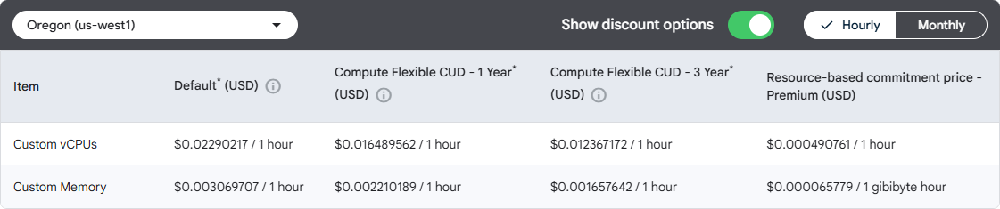
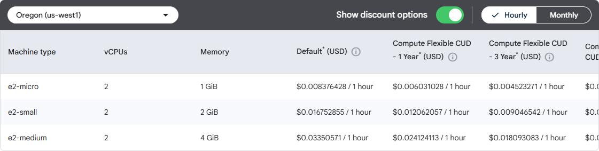

# SO U2 — orçamento mensal dos três cenários

Entrega da rubrica **Arquitetura em cenários + orçamento, item 2**. Consulta de preços: **19/10/2026**. Dependência: [arquitetura e dimensionamento](so-u2-cenarios-dimensionamento.md). Os valores abaixo são estimativas de planejamento, não uma fatura nem comprovação de capacidade homologada.

## 1. Resultado executivo

| Cenário | Custo mensal estimado (USD) | Reserva de planejamento de 15% | Limite para planejamento (USD) |
|---|---:|---:|---:|
| Baixo | **12,65** | 1,90 | **14,55** |
| Moderado | **63,07** | 9,46 | **72,53** |
| Alto | **234,15** | 35,12 | **269,27** |

O baixo representa o host compartilhado integral e o tráfego do Rota Vital. O moderado permite planejar a migração para persistência em PostgreSQL na mesma VM. O alto separa aplicação e banco para disputar menos CPU e memória, sem contratar alta disponibilidade. A escolha deve acompanhar as medições de RSD/POO e os gatilhos do item 1; o orçamento sozinho não demonstra necessidade de migração.

A reserva de 15% é uma decisão de planejamento, não uma tarifa do Google Cloud. Os totais não descontam créditos, contratos ou franquias gratuitas, cuja disponibilidade na conta não foi verificada. Também não incluem impostos, conversão cambial ou eventual tabela contratual em BRL. Não foi acessado o faturamento nem criado recurso de nuvem.

## 2. Premissas e vínculo com os diagramas

O provedor é **Google Cloud**, conforme a implantação documentada. A cotação usa **Oregon (`us-west1`)**, com zona proposta `us-west1-a`, alinhada à referência de deploy do projeto. Há registros antigos de outra região: a região e o SKU efetivos da VM não foram confirmados na conta. Portanto, Oregon é uma premissa explícita; uma implantação em outra região exige nova cotação.

| Cenário e diagrama | Compute Engine cotado | Disco provisionado | Backup externo |
|---|---|---|---|
| [Baixo](img/so-u2/cenario-baixo.png) | 1 `e2-micro`, 1 GiB RAM, host compartilhado de referência | 20 GiB `pd-standard` | Nenhum: H2 em memória não oferece persistência durável |
| [Moderado](img/so-u2/cenario-moderado.png) | 1 `e2-custom-2-4096`, 2 vCPU e 4 GiB RAM, aplicação + PostgreSQL | 40 GiB `pd-balanced` | Cloud Storage Standard regional |
| [Alto](img/so-u2/cenario-alto.png) | Aplicação `e2-custom-4-8192` (4 vCPU/8 GiB) + banco `e2-custom-2-4096` (2 vCPU/4 GiB) | 40 GiB aplicação + 120 GiB banco, `pd-balanced` | Cloud Storage Standard regional |

A `e2-micro` aproxima a memória histórica do host baixo; isso não identifica o SKU realmente contratado. Seus dois processadores visíveis compartilham **0,25 vCPU sustentada**, com possibilidade de rajadas. Para os cenários propostos foram escolhidas máquinas customizadas: `e2-medium` não substituiria 2 vCPU sustentadas, pois entrega CPU fracionária. [Especificações oficiais E2](https://docs.cloud.google.com/compute/docs/general-purpose-machines#e2_shared-core).

Convenções do cálculo:

- **730 horas/mês** de disponibilidade para VM, disco, IPv4 e armazenamento. As VMs continuam ligadas fora do período de uso.
- **30 dias com 8 horas/dia de tráfego**, conforme o modelo de carga anterior. Esta é uma convenção de consumo, distinta do mês médio de 730 horas usado para infraestrutura.
- Linux sem licença premium, contratação sob demanda, sem Spot ou compromisso de longo prazo. Os preços customizados publicados já incorporam seu adicional; não se soma outro percentual.
- Um IPv4 público por cenário, associado ao host de entrada Nginx. No alto, PostgreSQL usa somente IP privado, na mesma zona da aplicação.
- Discos zonais, sem réplica regional; bucket de backup na mesma região, classe Standard, namespace plano, sem versionamento adicional.

## 3. Preços utilizados e evidências

Valores em USD; na consulta das tabelas regionais foi selecionado **Oregon**, preço sob demanda/Default. O [catálogo versionado](../dados/precos-gcp-so-u2.json) preserva unidades, tarifas e fontes usadas no cálculo.

| Item | Tarifa | Fonte oficial |
|---|---:|---|
| `e2-micro` integral | 0,008376428 / VM-hora | [Compute Engine](https://cloud.google.com/products/compute/pricing/general-purpose?hl=en) |
| E2 custom CPU | 0,02290217 / vCPU-hora | [Compute Engine](https://cloud.google.com/products/compute/pricing/general-purpose?hl=en) |
| E2 custom memória | 0,003069707 / GiB-hora | [Compute Engine](https://cloud.google.com/products/compute/pricing/general-purpose?hl=en) |
| `pd-standard` | 0,000054795 / GiB-hora | [Persistent Disk](https://cloud.google.com/compute/disks-image-pricing?hl=en) |
| `pd-balanced` | 0,000136986 / GiB-hora | [Persistent Disk](https://cloud.google.com/compute/disks-image-pricing?hl=en) |
| IPv4 público em uso | 0,005 / IP-hora | [Rede VPC](https://cloud.google.com/vpc/network-pricing) |
| Cloud Storage Standard | 0,000027397 / GiB-hora | [Cloud Storage](https://cloud.google.com/storage/pricing?hl=en) |
| Operações classe A / classe B | 0,005 / 0,0004 por 1.000 operações | [Cloud Storage](https://cloud.google.com/storage/pricing?hl=en) |
| Saída Premium para América do Sul | 0,19 / GiB nos primeiros 1.024 GiB; 0,18 até 10.240 GiB; 0,15 acima | [Rede VPC](https://cloud.google.com/vpc/network-pricing) |

As capturas são evidências das páginas oficiais consultadas, não prints de uma fatura:





Evidências complementares: [tabela de discos em Oregon](img/so-u2-orcamento/discos-oregon.png) e [armazenamento Standard em Oregon](img/so-u2-orcamento/storage-oregon.png).

As tabelas podem apresentar franquias gratuitas. Aplicamos a tarifa paga ao volume integral para comparar cenários sem presumir saldo disponível; o [Free Tier](https://docs.cloud.google.com/free/docs/free-cloud-features) depende da elegibilidade e do consumo compartilhado da conta. O valor efetivamente cobrado pode ser menor ou variar conforme contrato e região.

## 4. Memória de cálculo e justificativa por item

Para cada recurso horário: `quantidade × 730 × tarifa`. Para a VM customizada: `730 × (vCPU × tarifa_CPU + GiB_RAM × tarifa_RAM)`. Por exemplo, a VM moderada custa `730 × (2 × 0,02290217 + 4 × 0,003069707) = US$ 42,40071264`.

| Item mensal (USD) | Baixo | Moderado | Alto | Justificativa no Rota Vital |
|---|---:|---:|---:|---|
| VM da aplicação, incluindo banco quando local | 6,11 | 42,40 | 84,80 | Java, Nginx, sistema operacional e processamento de bolsas, requisições e rotas |
| VM exclusiva do banco | — | — | 42,40 | Isola PostgreSQL das consultas HTTP e da ingestão de telemetria no alto |
| Disco | 0,80 | 4,00 | 16,00 | Sistema, aplicação, logs locais e dados persistentes; volumes do item 1 |
| IPv4 público | 3,65 | 3,65 | 3,65 | Entrada HTTPS única, sem IP público adicional no banco |
| Backup: três cópias ativas | — | 0,30 | 3,60 | Recuperação do estoque e do histórico persistidos |
| Backup: cópias excluídas retidas | — | 0,70 | 8,40 | Considera sete dias de soft delete, evitando subestimar armazenamento |
| Backup: operações classe A | — | 0,05 | 0,05 | Reserva de 10.000 operações/mês para gravação/listagem |
| Backup: operações classe B, arredondadas | — | 0,00 | 0,00 | 10.000 operações/mês custam **0,004**, mantidos no cálculo bruto |
| Saída de dados para usuários | 2,09 | 11,97 | 75,24 | Respostas da API/painel e folga de tráfego |
| Ajuste de arredondamento das linhas | 0,00 | 0,00 | 0,01 | O total é calculado antes de arredondar cada linha |
| **Total** | **12,65** | **63,07** | **234,15** | Antes da reserva de planejamento |

Os discos são cobrados pela capacidade provisionada, não somente pelos dados ocupados. `pd-balanced` acompanha a necessidade proposta de persistência; sua seleção não garante desempenho de I/O sem ensaio. CPU e memória de cada VM estão discriminadas no [CSV](../dados/orcamento-so-u2.csv), com valores brutos para auditar o arredondamento.

### 4.1. Tráfego derivado da carga da aplicação

Usamos as sessões e rotas dos diagramas: `RPS = sessões × 2/10 + rotas / intervalo_de_leitura`. O dimensionamento anterior adota 10 KiB por troca HTTP. Para uma estimativa conservadora de saída, tratamos todo esse volume como enviado ao cliente, acrescentamos 20% para protocolo, estáticos e pequenas rajadas e arredondamos para cima em GiB.

`GiB cotados = teto(RPS × 8 × 3.600 × 30 × 10.240 / 1.073.741.824 × 1,20)`

| Cenário | Sessões / rotas / intervalo | RPS médio | GiB base | GiB cotados | Custo USD |
|---|---|---:|---:|---:|---:|
| Baixo | 5 / 2 / 30 s | 1,0667 | 8,7891 | 11 | 2,09 |
| Moderado | 25 / 20 / 15 s | 6,3333 | 52,1851 | 63 | 11,97 |
| Alto | 100 / 100 / 5 s | 40 | 329,5898 | 396 | 75,24 |

O público foi modelado na América do Sul, com saída Premium a partir dos EUA. Os três consumos ficam na primeira faixa paga. A folga de tráfego de 20% dimensiona consumo; a reserva financeira de 15% cobre incerteza de planejamento e fica separada. Payloads, tempo efetivo de uso e destinos precisam ser substituídos por telemetria real antes de contratar capacidade.

### 4.2. Backup e retenção de objetos excluídos

Mantemos um dump diário e três cópias ativas: 5 GiB por dump no moderado e 60 GiB no alto, premissas do dimensionamento. Com a exclusão diária da cópia mais antiga e **sete dias de soft delete**, o regime estável contém mais sete dumps cobrados, embora não apareçam na listagem normal. Essa retenção adicional amplia a reserva de armazenamento externo prevista no item 1. [Comportamento e cobrança de soft delete](https://docs.cloud.google.com/storage/docs/soft-delete).

| Cenário | Ativo: 3 dumps | Excluído retido: 7 dumps | Total cobrado estimado |
|---|---:|---:|---:|
| Moderado | 15 GiB | 35 GiB | **50 GiB** |
| Alto | 180 GiB | 420 GiB | **600 GiB** |

É uma estimativa de regime estável, conservadora em relação ao primeiro mês. Alterar retenção, tamanho dos dumps, versionamento ou frequência exige recalcular. As reservas de 10.000 operações A e B são hipóteses de orçamento, não operações medidas. Standard permite essa rotação frequente sem prazo mínimo de armazenamento; classes frias não são necessárias para três backups diários. [Classes de armazenamento](https://docs.cloud.google.com/storage/docs/storage-classes#standard).

### 4.3. Serviços sem linha adicional e limites do escopo

Tráfego entre as duas VMs usa IPs privados na mesma zona; acesso ao bucket usa a mesma região. Nessas condições não acrescentamos transferência interna. No alto, a VM privada precisa de **Private Google Access** habilitado na sub-rede para enviar backups sem IPv4 próprio ou Cloud NAT. Administração ocorre por SSH privado via host da aplicação; pacotes podem ser preparados na imagem ou transferidos por esse host. Se for necessário acesso geral à Internet pelo banco, esta premissa deve ser revisada e o serviço de saída cotado. [Preços de rede](https://cloud.google.com/vpc/network-pricing), [acesso privado ao Google](https://docs.cloud.google.com/vpc/docs/private-google-access).

Nginx, systemd, Java, H2/PostgreSQL e logs locais usam os recursos já contabilizados; não há licença comercial incluída. Não foram previstos Cloud SQL, balanceador gerenciado, Kubernetes, Redis, NAT, discos regionais ou segunda zona, pois os diagramas não exigem esses serviços. TLS e o endereço já utilizados não representam nova contratação neste orçamento. Observabilidade gerenciada, custos de pessoal e consumo de CI/GitHub fora do Google Cloud não estão incluídos. A restauração considerada ocorre na mesma região; downloads de backup para fora dela devem acrescentar tráfego.

### 4.4. Custo compartilhado no cenário baixo

O host baixo também atende outras aplicações. Para não pressupor subsídio, o total principal inclui **100% de VM, disco e IPv4** de referência (US$ 10,56479944) e somente o tráfego modelado do Rota Vital (US$ 2,09). Portanto, não é o custo total de todos os sistemas do host.

Se houver um rateio acordado de fração `α`, o custo atribuído ao projeto seria `α × 10,56479944 + 2,09`. Um rateio meramente ilustrativo de 50% resulta em **US$ 7,37/mês**. Isso não comprova consumo de 50%. O acréscimo de custo fixo pode ser zero se a VM existente não mudar, mas o incremento efetivamente faturado depende de franquias e consumo da conta. “Compartilhado” não significa custo econômico nulo.

## 5. Decisões e sensibilidade

O moderado custa US$ 50,42/mês a mais que o baixo e adiciona persistência e recursos exclusivos para o Rota Vital. Justifica-se quando o ciclo de estoque exige durabilidade e as medições sustentam a migração; H2 em memória não substitui esse requisito. O alto acrescenta US$ 171,08/mês ao moderado: separar banco e aplicação deve responder à contenção observada, não somente ao número de usuários.

No alto, saída de dados representa cerca de 32% do total. Operar essa carga 24 h/dia, mantendo as demais hipóteses, levaria a 1.187 GiB cotados e US$ 223,90 de saída, aplicando as duas primeiras faixas. Isso **não valida a mesma arquitetura para 24 horas**: a retenção de telemetria também cresce e exige rever disco, backups e capacidade.

Uma centena adicional de GiB em `pd-balanced` custa aproximadamente US$ 10/mês; outro IPv4 público ativo, US$ 3,65/mês. Evitar um IP no banco e serviços sem necessidade mantém coerência com a rubrica de não exagerar na arquitetura. Novas exigências de alta disponibilidade, região brasileira, observabilidade ou retenção precisam de revisão formal do orçamento.

## 6. Subtarefas e validação da entrega

Resumos para o Jira, cada um com até 255 caracteres:

1. Identificar os recursos dos três cenários e definir as premissas de região, moeda, horas de uso e cobrança no provedor utilizado.
2. Consultar fontes oficiais de preços e calcular o custo mensal dos cenários baixo, moderado e alto.
3. Justificar cada item do orçamento, explicando recursos compartilhados, armazenamento, backups e tráfego.
4. Revisar os cálculos, documentar fontes e limitações e publicar a entrega com PR e evidências para o Jira.

As seções 2, 3–4 e 4–5 atendem, respectivamente, ao levantamento, à cotação e às justificativas. Este documento, as capturas, o catálogo, a planilha CSV e os resultados JSON materializam a revisão e as evidências. Os três orçamentos estão vinculados aos diagramas e às cargas do item 1.

Reprodução na raiz do repositório, com Python 3 e biblioteca padrão:

```powershell
python dados/orcamento_so_u2.py
python dados/orcamento_so_u2.py --check
python -m unittest discover -s dados -p test_orcamento_so_u2.py -v
```

O [script](../dados/orcamento_so_u2.py) importa a carga do item 1, lê o catálogo e gera [JSON](../dados/orcamento-so-u2-resultados.json) e [CSV](../dados/orcamento-so-u2.csv). Os testes conferem faixas de tráfego, retenção dos backups, totais/reserva e ausência de IPv4 público extra no alto. `--check` detecta resultados desatualizados. Nenhum desses comandos acessa a conta de nuvem ou provisiona infraestrutura.
